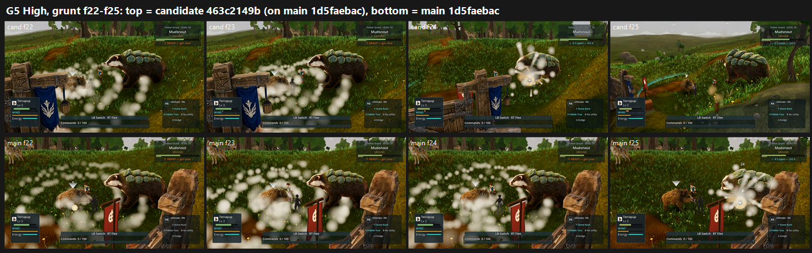

# G5 / P2-016 re-test 3 on GPU: tb/creatures-land 463c2149b vs main 1d5faebac (25 Oct 2026)

**Verdict: P2-016 is still NOT fixed, even on the current-main base.**

This round removes G4's confound: the candidate now includes #741 (flash at the feet, owner-named stagger lines), and the control is current main.
- **P2-016 calls, 24 per arm:**
  - Candidate: 19 PRESENT / 5 PARTIAL (Medium 9/3, High 10/2).
  - Main: 20 PRESENT / 4 PARTIAL (Medium 8/4, High 12/0).
- **Scores:**
  - Medium: candidate 5.81 vs main 6.19.
  - High: candidate 5.84 vs main 5.75.
- **Tier: below 6.** The candidate's lower preset is 5.81.

Across G, G2, G3, G4 and G5, no batch has called P2-016 FIXED.

## What the judges saw (all six)

- **The stagger label is there; the body isn't.**
  - "Mudsnout stagger" now appears by owner (Th A f20, Ul B f24–25, both on the candidate).
  - The boar's body does not change in those frames.
  - Judges read the badger rearing (Zj A f13, Th B f24, Tg A f15–16) as attack motion, and the boar's turns as ordinary facing changes.
- **Effects still bury the target:**
  - White "cotton-ball" and "bead-chain" puff trails cover the boar during the heavy wind-up (grunt f22–f23 on the sheet, and Gj, Om, Ul).
  - An impact flash still sits on the struck body (cand f24).
  - The heavy wind-up is the documented exception (protected, no flinch, by design), but its trail hides the creature completely, so the flinch around it cannot read either.
- **Camera:**
  - Fence posts, totems and banners fill the near plane (Gj, Th A f18–28, Cm B).
  - The hillside camera buries the boar behind foreground grass (Om B, Cm A).
  - Close frames show a flat grass carpet with no sky.

`_sheet_g5.png` (1.47 MB): High, grunt f22–25. The candidate is on top: the heavy-attack puff trail over Mudsnout, and the impact flash on the target at f24. Main is below.

## Run

- **Candidate:** `tb/creatures-land` 463c2149b = 288784257 (wince held 0.55 s) + a888fb436 (the Mosshock files), merged with main 1d5faebac. Verified.
- **Control:** main 1d5faebac. The lane checkout HEAD is 30f265cae, which is that merge plus GPU-PASS reports.
- **Capture:** `capture_f38_fight.gd --trainer=south_bridge_grunt,warden_aldis --frames=32 --interval=0.15 --attack --dodge --tell-frames` at 1920x1080, Forward+ on a GTX 1060.
- **Frames:**
  - Candidate: 79 at Medium, 89 at High.
  - Main: about 85 at Medium, 86 at High.

## Yardstick

- **Layout:** the same 8 sets and brief as G through G4.
- **Judges:** six fresh code-blind judges.

| Batch | Slope | Intercept | r | RMSE | Confirming |
|---|---|---|---|---|---|
| G5b1 (Medium) | 0.669 | 2.960 | 0.78 | 0.68 | yes |
| G5b2 (High) | 1.226 | −0.582 | 0.95 | 0.43 | yes |

## Path to FIXED

Five rounds now show the problem isn't timing (0.55 s is held), and it isn't flash placement alone.

1. **Make the reaction big enough to read from this camera** (*new_art* or *rig*): a head drop of about a third of body height, plus a short body recoil away from the attacker. Make it larger than the idle sway and the facing turns. The current wince isn't visible at strip size.
2. **Never cover the reacting creature:**
   - Cap the heavy-attack puff trail's opacity, or route it behind the target.
   - Keep the impact flash at the feet and smaller than the creature. The cand f24 flash still sits on the body.
3. **Frame the fight:** keep fence posts, totems and banners out of the near plane, and avoid the low hillside angle.
4. **Re-test cheaply:** about 20 minutes on GPU with this same layout once item 1 lands.

## Files

- `_sheet_g5.png`, `build_yard_G5.ps1.txt`.
- `yardstick/b1`–`b2`:
  - `key.json`, `sets.md`, `candidates.json`, `recorded_defects.txt`, `judge_prompt_filled.txt`;
  - `j1`–`j3`;
  - `batch.json`, `mapped.json`.
