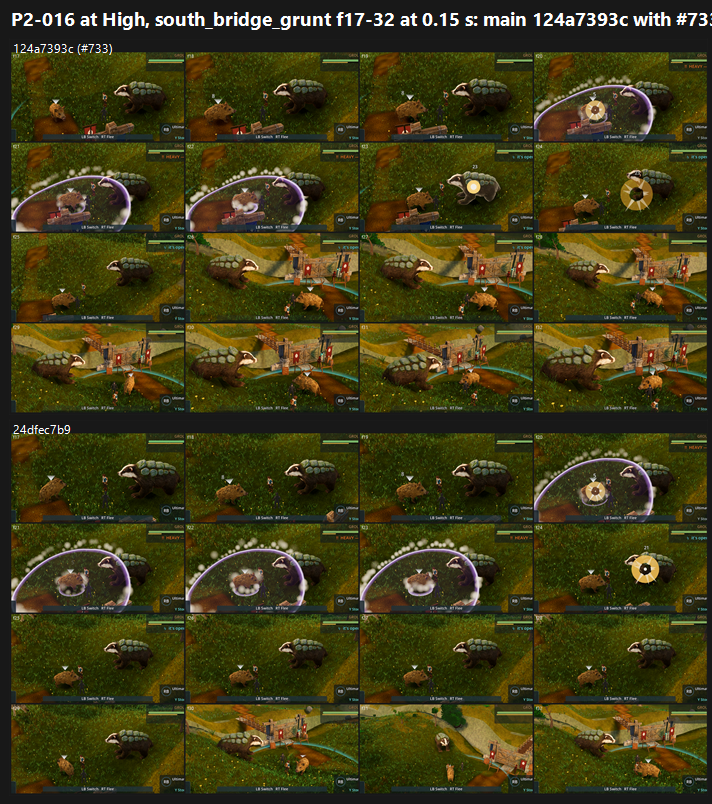

# G / P2-016 hurt poses in real fights on GPU: #733 (main 124a7393c) vs main 24dfec7b9 (24 Oct 2026)

**Verdict: P2-016 is PARTIAL with #733, not FIXED.**

- **Improved at High:** the control's majority call was PRESENT (10 of 12 judge calls); with #733 it becomes PARTIAL (9 of 12).
- **No change at Medium:** both arms are PARTIAL by majority (#733: 8 PARTIAL / 4 PRESENT; control: 9 / 3).
- **Where it fails:** the small creature now visibly rears, leans and crouches after hits. The large armoured badger still holds its idle silhouette under every hit, even while a STAGGER label is up.
- **Roles corrected after the first push** (per the Creatures lane, 24 Oct): in the grunt fight the large armoured badger is the **player's** fixture Terrapup (the badger mesh on main), and the small creature is the **enemy** Mudsnout.
  - So it is the player's Terrapup badger that keeps its idle silhouette, while the enemy reacts.
  - The first push of this file had the roles the other way round.
  - G2 (cf2d4258a) targets exactly this: it doubles the badger's recoil.
- **Tier: 6–7.** The fights themselves map to 5.6–6.7.

## Run

- **Candidate:** main 124a7393c (#733, the P2-016 merge).
- **Control:** main 24dfec7b9.
- **Capture:** `tools/capture_f38_fight.gd --trainer=south_bridge_grunt,warden_aldis --frames=32 --interval=0.15 --attack --dodge --tell-frames --preset=<Medium|High> --source-commit=<sha>`.
  - Run at 0.15 s so the 0.25 s wince lands on frames.
  - Forward+ on a GTX 1060, at 1920x1080.
- **Frames:**
  - Candidate: Medium 83, High 86.
  - Control: Medium 80, High 83.
  - The control's warden fight ended after frame 29 at Medium, so that set shows 13 frames on that side.

## Yardstick

- **Sets:** 8, one per trainer × half (frames 01–16, 17–32) × preset. Each side is a 4×4 grid of 16 consecutive frames, cropped to the field (`build_yard_G.ps1.txt`).
- **Judges:** two batches, three fresh code-blind judges each, given `JUDGE_PROMPT.md` verbatim with 4 anchor pairs.
- **Recorded defect:** "P2-016: hurt and moving frames keep the idle silhouette".

| Batch | Slope | Intercept | r | RMSE | Confirming |
|---|---|---|---|---|---|
| Gb1 (Medium) | 0.673 | 3.271 | 0.80 | 0.64 | yes |
| Gb2 (High) | 0.881 | 1.663 | 0.89 | 0.55 | yes |

### Mapped scores and P2-016 per set (#733 vs control)

| Set | #733 | Control | P2-016 votes (both arms) |
|---|---|---|---|
| Medium grunt f01–16 | 6.10 | 5.94 | 4 PARTIAL / 2 PRESENT |
| Medium grunt f17–32 | 6.55 | 6.48 | 6 PARTIAL |
| Medium warden f01–16 | 6.68 | 6.59 | 4 PARTIAL / 2 PRESENT |
| Medium warden f17–32 | 6.25 | 6.66 | 3 / 3 (the control side has 13 frames) |
| High grunt f01–16 | 5.69 | 5.63 | 1 PARTIAL / 5 PRESENT |
| High grunt f17–32 | 6.30 | 5.92 | 3 / 3 |
| High warden f01–16 | 6.39 | 6.13 | 3 / 3 |
| High warden f17–32 | 6.19 | 6.21 | 4 PARTIAL / 2 PRESENT |
| **Mean, Medium** | **6.39** | **6.42** | #733: 8 PARTIAL / 4 PRESENT; control: 9 / 3 |
| **Mean, High** | **6.14** | **5.97** | #733: 9 PARTIAL / 3 PRESENT; control: 2 / 10 |

`_sheet_p2016.png` (1.37 MB): High, grunt frames 17–32, #733 (top) vs control (bottom). The per-set vote tallies are in `p2016_states.json`.

## What the judges saw

- **Reactions that do show (#733):**
  - the small creature crouches after the dust impact (warden, frames 25–28);
  - it rears in frames 16–18;
  - a badger lunge or rear in single frames: grunt 14, warden 23 and 26–27.
- **Still idle:**
  - the enemy badger under hit rings and STAGGER labels;
  - the small creature under direct hits in several runs. One judge noted "a STAGGER label instead of a stagger".
- **Readability problems hiding what reactions there are:**
  - flat lavender telegraph wedges and domes cover the creatures (P2-063);
  - a near-top-down camera in the grunt's opening frames;
  - the enemy is off screen for frames 01–13 in one run;
  - per-frame camera cuts in the grunt's second half;
  - the HUD is clipped at the right edge ("Ultimat", "Y Sto").

## Path to 7.5 (P2-016 to FIXED; the fight is at 5.6–6.7)

1. **A visible hit reaction on the large armoured badger**, the player's Terrapup (*new_art*, animation): a flinch or recoil on each hit and a real stagger pose while STAGGER shows. The badger is the reason the majority call stays PARTIAL. G2 (cf2d4258a, doubled recoil and a held wince) is queued to measure exactly this.
2. **Make the wince last on screen** (*scene*, animation tuning): 0.25 s barely survives 0.15 s sampling, and at 30 fps play it is about 7 frames. Lengthen it to around 0.35–0.4 s, or add a squash and recoil key, so it reads.
3. **Stop the telegraph shapes covering the creature** during its reaction (*scene*, P2-063): thin outlines instead of filled lavender domes.
4. **Combat camera** (*scene*): keep both fighters framed, with no top-down opening and no per-frame cuts. This is the same as F38 L1 and the F40 fight.

## Files

- `_sheet_p2016.png`, `p2016_states.json`, `build_yard_G.ps1.txt`.
- `yardstick/Gb1`, `yardstick/Gb2`:
  - `key.json`, `sets.md`, `candidates.json`, `recorded_defects.txt`, `judge_prompt_filled.txt`;
  - `j1`–`j3` (the judges' own blocks);
  - `batch.json`, `mapped.json`.
- Per-frame captures stay local.
