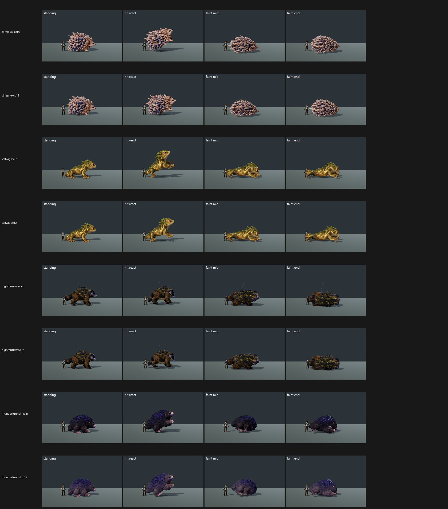

# CO12 on main: four near-bar creatures on GPU, tb/co12-main-on e5fcc1c47 vs main d4d5b262f (31 Oct 2026)

**Verdict: land all four changes. Every species gains and none regresses. Thundertunnel (+0.87 mean) and Cliffspike (+0.53) are qualifying gains. Nightburrow's flame-out is a clean defect fix (+0.44). Voltwig gains at High (+0.58) and holds at Medium (+0.04). No species meets 7.5.**

| Species | Change | Medium main → co12 | High main → co12 | Key defect main → co12 | MET (co12) |
|---|---|---|---|---|---|
| **thundertunnel** (--candidate) | fur value lift | 5.73 → **6.49 (+0.76)** | 5.52 → **6.50 (+0.98)** | near-black fur PRESENT 3/3 → PARTIAL 3/3 (Medium); PRESENT 3/3 → PARTIAL 2 / FIXED 1 (High) | not met (6.49 / 6.50) |
| **cliffspike** (--candidate) | grounded flinch | 6.19 → **6.72 (+0.53)** | 6.19 → **6.72 (+0.53)** | flat or airborne hit react PRESENT 3/3 → PARTIAL 2 / FIXED 1 (Medium); PRESENT 3/3 → PARTIAL 3/3 (High) | not met (6.72 / 6.72) |
| **nightburrow** (plain) | aspect flame out on faint | 6.23 → 6.67 (+0.44) | 6.23 → 6.67 (+0.44) | flame lit on the fainted body PRESENT 3/3 → **FIXED 3/3** at both presets | not met (6.67 / 6.67) |
| **voltwig** (--candidate) | grounded flinch | 6.75 → 6.79 (+0.04) | 6.40 → **6.98 (+0.58)** | hit react PRESENT 3/3 → **FIXED 3/3** (High); PRESENT 2 / PARTIAL 1 → PRESENT 1 / PARTIAL 2 (Medium) | not met (6.79 / 6.98) |

The floating-faint defect is FIXED 3/3 on both arms of every species. No judge saw a body-to-shadow gap at the judged size; they noted the strips were small.

**For ROSTER-1 (coordinator):** take the co12 Thundertunnel result, 6.49 / 6.50. It is not met.

## Gap to 7.5 and fixes (from the judges' notes, paraphrased)

- **Thundertunnel (gap 1.0):**
  - The lifted fur still reads as "a dark mound with no readable face"; lift the values further and add a rim light so form and face separate from the stage.
  - Its faint barely differs from standing.
  - It stands only about trainer height. All creatures are meant to stand taller than the 1.80 m trainer.
- **Cliffspike (gap 0.78):**
  - Its faint "reads as a crouch, not a collapse": make the faint end a real collapse.
  - The face is lost in the quills.
  - At High the co12 hit react still lifts slightly (PARTIAL 3/3).
- **Nightburrow (gap 0.83):**
  - The flame now goes out, but the coat (muddy brown with yellow-speckled plates) reads noisy.
  - The faint end is a crouch rather than lying on its side.
  - Judges ask for real fur and plate detail.
- **Voltwig (gap 0.52 at High, 0.71 at Medium):**
  - At Medium the co12 hit react is still read as lifting (PRESENT 1 / PARTIAL 2). Lower its peak so the hind feet stay planted at both presets.
  - The brassy skin is "all one middle tone"; give it value contrast and markings.

## Capture

- **Tool:** `tools/art_pipeline/capture_f36_poses.gd --whole-body --context`, one run per species, standard roster crop.
- **Arms:** each arm on its own clean, imported tree: main d4d5b262f and co12 e5fcc1c47, with `--source-commit=<sha>`.
- **Renderer:** Medium and High on the GTX 1060, Forward+/Vulkan, isolated APPDATA preset.
- **Candidate flag:**
  - Cliffspike, Voltwig and Thundertunnel were shot with `--candidate`, as asked.
  - **Deviation:** Nightburrow was shot **plain**. It is not in `f36_pose_candidates.json` `enabled_species` on either arm, so `--candidate` would abort it. The flame-out is in `creature_body.gd`, so it shows in a plain shot, and plain is how the game shows Nightburrow.
- **Frames:** all 16 runs exited 0 with 10 frames each (hit and faint, 0–100%). None of the four has a travel-role frame.

## Method

- **Sets:** 8 two-sided sets (4 species × 2 presets, co12 vs main) in 2 batches with 4 anchor pairs each, three code-blind judges per batch, high anchors.
- **Fit:** r 0.93 / 0.85, RMSE 0.47 / 0.55, both confirming.
- **Side placement:** shuffled by the batch key. Set codes:
  - Kf thundertunnel Medium, Rw thundertunnel High;
  - Wo cliffspike Medium, Ra cliffspike High;
  - Jx nightburrow Medium, Hf nightburrow High;
  - Hd voltwig Medium, Wp voltwig High.

`_sheet_co12.jpg`, High: each species shows the main row above the co12 row (standing, hit react, faint mid, faint end).
- Cliffspike and Voltwig hit reacts stay on the ground on co12 and leave it on main.
- Nightburrow's faint has no flame on co12.
- Thundertunnel's fur is lifted to violet-grey.

The yardstick files are in `yardstick/`.
