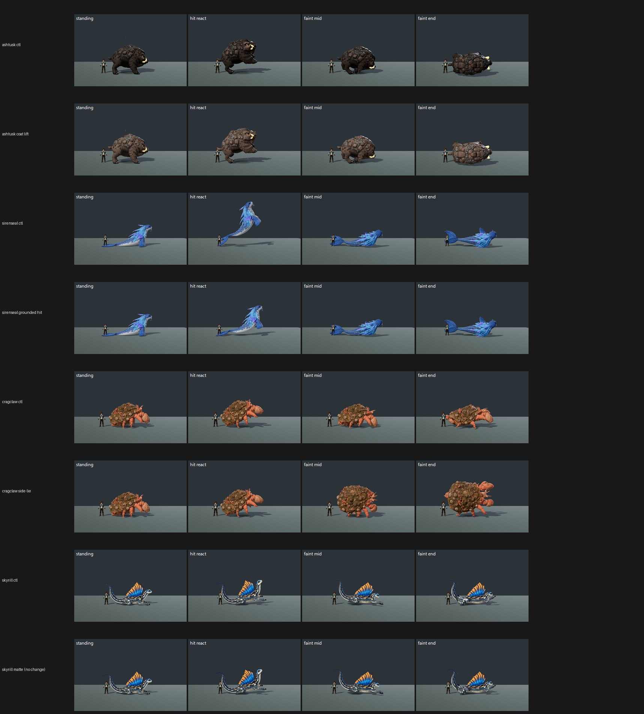

# CO16: creatures one-tree, CO-F36-1 to CO-F36-9 as flag flips at High (31 Oct 2026)

**Verdict, per arm:**
- **Land:**
  - the coat lifts (CO-F36-4, CO-F36-5);
  - Sirenseal's grounded hit (CO-F36-2);
  - the three height arms (CO-F36-3, CO-F36-8, CO-F36-9);
  - the Cindercub/Trailpup hit (CO-F36-6).
- **Don't land:**
  - **CO-F36-1** (side-lie faints): Cragclaw −0.65 and water Cragclaw −0.61, and the rolled body now floats.
  - **CO-F36-7** (matte finish): it had **no visible effect**, so it can't be judged as built.
- **Cindercub with the coat lift maps to 7.51 at High**, so it gets a Medium run (queued) for its MET line.
- Nothing else reaches 7.5.

High, control (tree A, every flag off) → candidate (one flag on):

| Arm (flag) | Species | High ctl → cand | Arm's defect, ctl → cand | Read |
|---|---|---|---|---|
| **CO-F36-4** coat lift | ashtusk | 5.97 → **6.96 (+0.99)** | dark coat PRESENT 3 → **FIXED 3** | land |
| | **cindercub** | 6.89 → **7.51 (+0.62)** | PARTIAL 3 → **FIXED 3** | land; **High ≥ 7.5 → Medium queued** |
| | duskhush | 6.06 → **6.85 (+0.79)** | PRESENT 3 → PARTIAL 3 | land |
| | thundertunnel | 6.47 → 6.82 (+0.35) | PRESENT 2 / PARTIAL 1 → PARTIAL 2 / FIXED 1 | land |
| **CO-F36-2** Sirenseal grounded hit | **sirenseal** | 6.17 → **7.07 (+0.90)** | airborne hit PRESENT 3 → PARTIAL 3 | land |
| | water_sirenseal (no-change check) | 7.12 → 7.17 (+0.05) | PARTIAL 3 → PARTIAL 3 | unchanged, as intended |
| **CO-F36-5** coat lift 2 | stormtrail | 6.18 → **6.82 (+0.64)** | PRESENT 1 / PARTIAL 2 → **FIXED 3** | land |
| | shadelet | 6.06 → **6.58 (+0.52)** | PRESENT 3 → PARTIAL 3 | land |
| | nightburrow | 5.66 → 5.80 (+0.14) | PRESENT 2 / PARTIAL 1 (unchanged) | small |
| **CO-F36-9** taller (×1.5–1.8) | riftfrill | 6.04 → **6.68 (+0.64)** | too short PRESENT 3 → PARTIAL 2 / FIXED 1 | land |
| | paddlenewt | 6.49 → 6.85 (+0.36) | PRESENT 2 / PARTIAL 1 → PARTIAL 2 / FIXED 1 | land |
| | mudsnout | 7.11 → **7.40 (+0.29)** | PRESENT 1 / PARTIAL 2 → PARTIAL 1 / FIXED 2 | land; 0.10 short |
| **CO-F36-8** taller (×1.6) | pipwing | 6.71 → 7.19 (+0.48) | PRESENT 1 / PARTIAL 2 → **FIXED 3** | land |
| | sparkit | 5.41 → 5.83 (+0.42) | PRESENT 3 → PARTIAL 3 | land |
| **CO-F36-3** taller | duskhush | 6.49 → 6.84 (+0.35) | PARTIAL 3 → **FIXED 3** | land |
| | brooktail | 6.39 → 6.63 (+0.24) | PARTIAL 3 → **FIXED 3** | land |
| **CO-F36-6** stronger grounded hit | cindercub | 6.50 → 6.82 (+0.32) | flat hit PRESENT 1 / PARTIAL 2 → PARTIAL 1 / FIXED 2 | land |
| | trailpup | 6.64 → 6.92 (+0.28) | PRESENT 3 → PARTIAL 3 | land |
| **CO-F36-1** side-lie faints | skyrill | 5.96 → 6.15 (+0.19) | faint end PRESENT 3 → **FIXED 3**, but **float FIXED/PARTIAL → PRESENT 3** | not as is |
| | cragclaw | 6.71 → **6.06 (−0.65)** | float FIXED 3 → PRESENT 1 / PARTIAL 2 | **don't land** |
| | water_cragclaw | 7.29 → **6.68 (−0.61)** | faint end mostly FIXED → **PRESENT 3**; float FIXED 3 → PRESENT 1 / PARTIAL 2 | **don't land** |
| **CO-F36-7** matte finish | skyrill, voltarach, cragclaw, sparkit, reedwing | **identical: +0.00 on all five** | unchanged | **no effect, see below** |

**CO-F36-7 matte: the flag did not change the render.**
- The flip receipt shows `flags.creatures_f36_matte_finish.enabled: false -> true` on the captured tree.
- But the candidate frames match the control within noise: mean absolute RGB difference 0.05–0.14 across all five species' standing and faint frames, so the chrome, plastic and gold surfaces are unchanged.
- **Likely cause:** in `data/config/creature_coat_flags.json`, this flag's `coats` is a list of five albedo paths. `creature_body.gd::_coat_flag_map()` reads `coats` as a Dictionary of `{albedo_path: {"metallic"?, "roughness"?, "specular"?}}`, so no material values apply. Nothing is logged.
- **Fix:** make `coats` a dictionary carrying the metallic, roughness and specular values listed in the CO-F36-7 request, then re-run this arm.

**CO-F36-1 side-lie faints: the roll floats the body.**
- On Cragclaw and water Cragclaw the judges now see the fainted body above its shadow (PRESENT or PARTIAL, against FIXED 3 on control).
- Water Cragclaw's faint end gets worse (PRESENT 3).
- Skyrill's faint end is FIXED 3, but it floats (PRESENT 3).
- Grounding on the posed skin does not seem to hold through the added 70° pivot roll. Check the contact sample for the rolled frames before re-sending.

**Gap to 7.5, what the judges still ask for:**
- **Coat-lift species:** a rim light so near-black and charcoal coats separate from the stage (nightburrow, thundertunnel, duskhush, shadelet); duskhush also needs height, which CO-F36-3 provides.
- **Mudsnout (7.40):** its faint still reads alert; it is 0.10 short.
- **Sparkit (5.83) and the fennec:** both still sit upright in faint end, and the surface reads toy-like. CO-F36-7 was meant to address the surface.
- **Pipwing (7.19):** height FIXED; the next step is faint grounding.
- **Sirenseal (7.07):** its hit now reads PARTIAL instead of airborne; one more step down on the hit pitch.

**Capture:**
- **Tree A:** local commit c4806f1ab = tb/world-2-on 1bfc5d095 + tb/co-f36-9-on e8da58fe1, every lane flag off, imported once. Not pushed.
- **Arms:**
  - Control = tree A.
  - Each arm flips exactly one flag, receipts in `CO16-flips.txt`.
  - CO-F36-1 and CO-F36-2 copy a pose JSON built on tree A's own `f36_pose_candidates.json`: the Sirenseal flag set to true, or co-f36-1 e5667aecd's Cragclaw and Skyrill profile lines.
- **Command:** `capture_f36_poses.gd --whole-body --context`, High, standard crop. One launch per arm per mode (`--candidate` for recipe species, plain for own-clip species, as in the lane's table). No species dropped out of a group run.

**Method:**
- 26 two-sided sets in 3 batches, each with 4 anchor pairs, three code-blind judges per batch, high anchors.
- Fits r 0.86 / 0.90 / 0.97, RMSE 0.44 / 0.58 / 0.27, all confirming.

`_sheet_co16.jpg` (High): ashtusk coat lift, sirenseal grounded hit, cragclaw side-lie faint (floats), and skyrill matte (identical to control).
