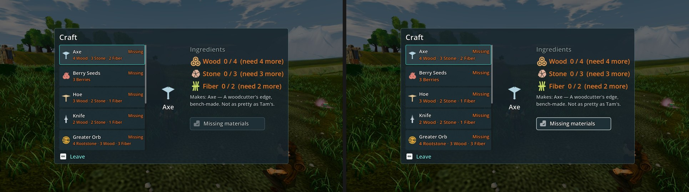

# CRAFT-R3: P2-095 close-out, round 2, as a flag flip at High (31 Oct 2026)

**Verdict: a small consistent gain, not a close-out. High: control 7.17 → readable_r3 7.32 (+0.15). All three judges score the candidate about 0.2 higher (raw), and two of them name the bordered "Missing materials" button. Below 7.5, so no Medium run is due, and F38#18 stays open. The clipping defect is FIXED 3/3 on both arms.**

| Item | Flag | High control → candidate | Judges (raw, control / candidate) | Defect | MET |
|---|---|---|---|---|---|
| P2-095 craft recipe text | `data/config/craft_presentation.json` `readable_r3: true` | 7.17 → **7.32 (+0.15)** | 6.6 / 6.8, 6.3 / 6.5, 6.6 / 6.8 | clipping FIXED 3 → FIXED 3 | not met (Medium not run) |

**On the absolute level:** P2-095's control maps to 7.17 here and 7.43 in this morning's close-out. The raw scores are the same (6.3–6.6 here, 7.0–7.2 there, from different judges). This batch's fit is flatter (slope 0.74, r 0.89, RMSE 0.40), so read the +0.15 gain, not the level.

**Gap to 7.5 and fixes** (the judges, paraphrased):
1. **Material lines still tiny:** the orange sub-lines under each recipe are "tiny for a 7-inch screen" on both arms. readable_r3's one-step increase is not enough; go another step, or show fewer, taller rows.
2. **Empty centre column:** a small flat Axe glyph sits in a mostly empty middle column. A proper item preview would fill it.
3. **Controller prompt:** the Leave hint shows an Esc keycap.
   - This capture uses the job's keyboard repro command; with `--gamepad` (UI-PAD) the hint uses controller glyphs.
   - A pad close-out would judge the screen the Ally actually shows.
4. **Keep the border:** the candidate's pale focus border on the disabled button helps controller play.

**Capture:**
- **Tree:** one imported tree, local commit 402a80f3a (not pushed): main d4d5b262f + tb/dialogue-cam + tb/ui-near-bar + tb/craft-r3 86a1c9825, all flags off.
- **Arms:**
  - Control = that tree.
  - Candidate = the same tree with `readable_r3` flipped to `true`. The receipt in `flips.jsonl` reads "readable_r3: false -> true".
- **Command:** P2-095's job.json repro, `phase2_capture_build_systems.gd --biome=meadows --seed=2042`.
- **Settings:** High, GTX 1060, Forward+, `--fullscreen`, `--source-commit=402a80f3a…`, `--preset=High`.
- **Result:** both runs exited 0 with 4 frames.

**Method:**
- One two-sided set (control vs candidate) plus 4 anchor pairs, three code-blind judges, high anchors.
- Set code Us: A = control, B = candidate.

`_sheet_craftr3.jpg`: control (left) and readable_r3 (right) at High.
- On the right, the "Missing materials" button has a bright border and white label.
- On the right, the sub-lines and Missing tags are a step larger.
