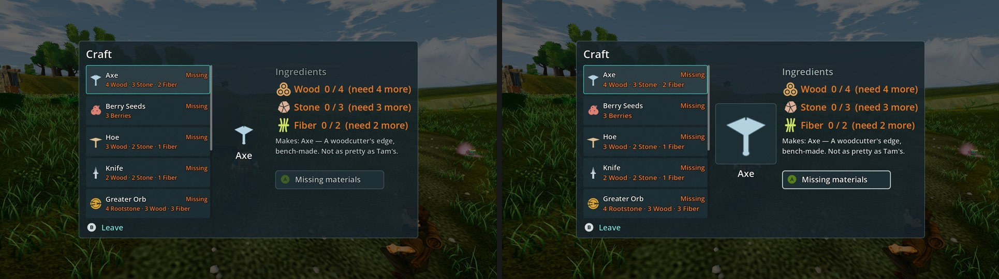

# CRAFT-R3b: P2-095 pad close-out (readable_r3 round 2 + UI-R2 tokens, --gamepad), High (31 Oct 2026)

**Verdict: the best P2-095 result yet, but not a close-out. High: control 6.88 → candidate 7.31 (+0.43). All three judges score the candidate 0.4–0.6 higher (raw). It is 0.19 short of 7.5, so no Medium run is due, and F38#18 stays open. Clipping is FIXED 3/3 on both arms.**

| Item | Arms (both `--gamepad`) | High control → candidate | Judges (raw control / candidate) | Defect | MET |
|---|---|---|---|---|---|
| P2-095 craft recipe text | control = main (tree as-is); candidate = tb/craft-r3 head 489f6de20 with `readable_r3: true` + UI-R2 `ui_tokens.gd` | 6.88 → **7.31 (+0.43)** | 5.8 / 6.4, 6.0 / 6.4, 5.8 / 6.3 | clipping FIXED 3 → FIXED 3 | not met (Medium not run) |

**What the candidate shows:**
- a 200 px item preview on its own plate in the centre column;
- controller prompts (A on the craft button, B for Leave);
- the bordered "Missing materials" button.

All three judges name the framed preview as the gain ("better hierarchy").

**Gap to 7.5 (0.19), the judges' remaining asks:**
1. **The item icon:** the axe glyph is "a flat T shape that does not read as an axe". All three call the icons flat placeholders, so a real item icon or render would help most.
2. **Material sub-lines:** the orange lines in the list are still "too small to read on a 7-inch screen". Go one more step up, or show fewer, taller rows.
3. **Note:** some judges mention a "system crafting" label in the top left. That is the GPU lane's own caption on the judging sheet, not in the game, so ignore it.

**Capture:**
- **Tree:** one imported tree, local 402a80f3a.
- **Candidate flips** (receipts in `flips.jsonl`):
  - `scripts/ui/craft_panel.gd` and `data/config/craft_presentation.json` copied from 489f6de20;
  - `readable_r3` set to `true`;
  - `scripts/ui/ui_tokens.gd` copied from f6ee5c6d5.
- **Command and settings:** P2-095's job.json command with `--gamepad`, High, Forward+, `--source-commit`, `--preset=High`.

**Method:**
- One two-sided set plus 4 anchor pairs, three code-blind judges, high anchors.
- Fit r 0.92, RMSE 0.52.

`_sheet_craftr3b.jpg`: control (left) vs candidate (right) at High, both with controller glyphs.
