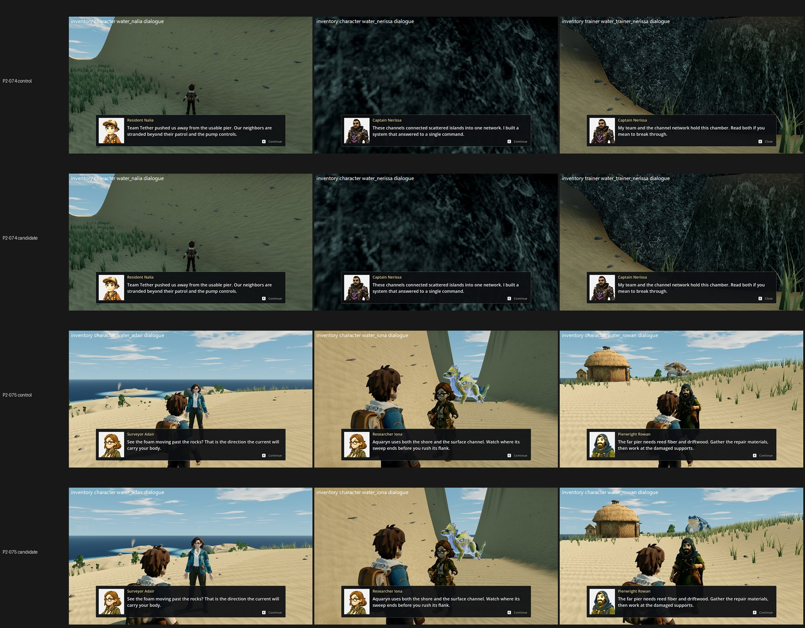

# DLG-1: dialogue camera arm on GPU, High (31 Oct 2026)

**Verdict: no net gain, so don't land it for these items. The candidate's camera.json changes nothing where the dialogue camera never engages, and that is where the worst items are. Mean change over 12 items ≈ 0.00: P2-075 +0.42, P2-078 −0.17, P2-079 −0.16, the other nine identical. Nothing reaches 7.5 at High, so no Medium run is due.**

**The diagnosis the arm was for:** in **14 of 34 dialogue frames the conversation camera never engages, on either arm.** The manifest shows `conversation_camera_active: false, blend 0`, and the camera stays at the default 70° FOV at 5.77 m. Neither `sight_search_short_arm` nor `speaker_frame_candidate_enabled` can act there, because the push-in has not fired.

That covers every frame of the three worst items:
- **P2-074** (camera inside the rock wall at Nerissa);
- **P2-073** (Daro, Bex, Irva small and distant);
- **P2-076** (Kelm and Veyra absent).

It also covers both Captain Marrow frames, the item P2-083 depends on.

| Item | High control → candidate | Defect (control → candidate) | Push-in, per frame (from the manifests) |
|---|---|---|---|
| P2-086 tournament speakers | **7.33 → 7.33** | same-character FIXED 3 → FIXED 3 | Mira, Tam, Oskar fire; same shot |
| P2-077 Tavi / Sora / Rusk | 6.93 → 6.93 | FIXED/PARTIAL (unchanged) | fires on all; Rusk closer on the candidate. Control Sora frame missing* |
| P2-075 Adair / Iona / Rowan | 6.32 → **6.74 (+0.42)** | player overlaps speaker PRESENT 2 / PARTIAL 1 → **PARTIAL 3** | fires on all; Adair and Rowan closer on the candidate |
| P2-081 named trainer identity | 6.38 → 6.38 | FIXED 3 | Wen, Senn fire; same shot. **Marrow (dynamo core) never fires** |
| P2-084 Fenn / Oswin / Maud | 6.29 → 6.29 | FIXED 3 | fires on all; same shot (the Fenn frame is near-black, a new note) |
| P2-078 Kell / Corin / Field | 5.22 → 5.05 (−0.17) | creature intrusion PRESENT 3 → PRESENT 3 | Corin, Field fire; same shot. **Kell never fires** |
| P2-079 Quarry foreman / Garrick | 5.18 → 5.02 (−0.16) | rock face PRESENT 3 → PRESENT 3 | fires; the candidate's closer Garrick shot puts more rock in frame |
| P2-087 Bram / courtyard / elite | 5.12 → 5.12 | speaker not shown PRESENT 3 | Bram fires; **courtyard and elite never fire** |
| P2-073 Daro / Bex / Irva | 5.05 → 5.05 | small distant speaker PRESENT 3 | **never fires (all three)** |
| P2-083 Marrow / Nysa | 4.45 → 4.45 | banner hides speaker PRESENT 3 | **Marrow ×2 never fire**; Nysa fires in fallback |
| P2-076 Kelm / Veyra | 4.39 → 4.39 | speaker absent PRESENT 3 | **never fires (all three)** |
| P2-074 Nalia / Nerissa | 3.79 → 3.79 | no identifiable speaker PRESENT 3 | **never fires (all three)**; camera in the rock wall |

*The control's c021 Sora frame was killed twice by a too-tight stall watchdog, so P2-077 is judged on its other two frames. A gap-fill run is queued; it does not change the conclusion.

**Where the fix has to go (from the manifests and the judges):**
1. **Make the push-in engage.**
   - Every "never fires" frame keeps the exploration camera: 70°, 5.77 m, `conversation_camera_shot` empty, no fallback.
   - Why `begin()` does not activate for these 14 speakers needs a code-side look. Compare them with the speakers that do engage; the manifests are pushed for exactly this.
   - The optional `speakers.txt` print at `conversation_camera.gd::begin()` was **not** made. Adding it would mean editing the tree outside the arm commits, and the manifests already separate never-fired from fired.
2. **Then frame and clear the shot**, which is what the judges ask on every item:
   - a speaker-centred two-shot beside the panel;
   - occlusion handling for rock faces (Garrick, Nerissa), banners (Marrow), large creatures (Corin) and the player's head (Rowan).
   - The candidate's short-arm search only helps once the push-in runs, and on Garrick it moves the camera nearer the rock.
3. **Other notes (not the camera):**
   - a red banner on a friendly post (Captain Halder), against the red-reserved-for-Team-Tether rule;
   - Fenn's frame is a black void.

**Capture:**
- **Tree:** one imported tree, local commit aab079c80 → 402a80f3a (main d4d5b262f + tb/dialogue-cam 57c9418e8 + tb/ui-near-bar + tb/craft-r3, all flags off).
- **Arms:**
  - Control = that tree.
  - Candidate = the same tree with `data/config/camera.json` copied byte for byte from tb/dialogue-cam-on 8486a5363 (sha256 ed9c316a7515, receipt in `flips.jsonl`).
- **Commands and settings:** the 12 items' job.json `phase2_capture_dialogue.gd` commands (34 frames), High, Forward+, GTX 1060, `--fullscreen`, `--source-commit`.
- **Retries:** two Tidewake commands hung once each at High and passed on retry.

**Method:**
- 12 two-sided sets (candidate vs control) in 2 batches with 4 anchor pairs each, three code-blind judges per batch, high anchors.
- Fits r 0.83 / 0.92, RMSE 0.64 / 0.53, both confirming. Batch 2 has one anchor warning.

**Files:**
- `diag-dialogue/<biome>/{control,candidate}/<cmd>-manifest.json`: every capture's manifest, both arms.
- `diag-dialogue/diag_rows.json`: per frame, both arms' `conversation_camera_active/blend/fallback/shot`, distance, FOV, and the control-vs-candidate pixel difference.
- `yardstick/`: the judge files.

`_sheet_dlg1.jpg`: P2-074 (no push-in on either arm, so the camera stays in the rock wall: identical) and P2-075 (push-in fires; the candidate frames Adair and Rowan closer).
