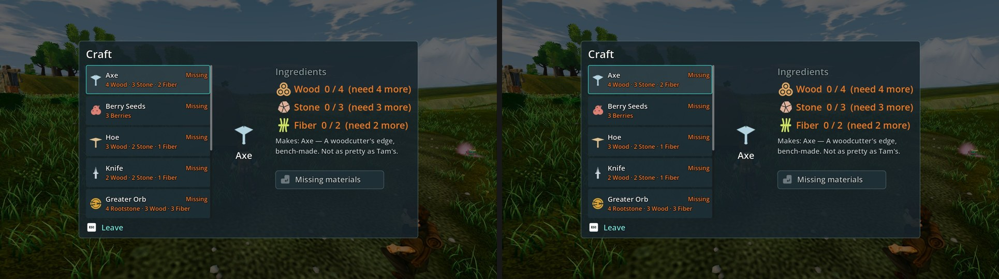

# P2-095 close-out: Meadows craft recipe text at Medium and High on main d4d5b262f (31 Oct 2026)

**Verdict: not met. 7.43 at Medium and 7.43 at High, 0.07 short of the 7.5 close-out, so F38#18 stays open. The catalogue defect (clipped recipe text) is FIXED 3/3 at both presets.**

| Item | Medium | High | Defect | MET |
|---|---|---|---|---|
| P2-095 craft recipe text (F38#18) | 7.43 (judges 7.57 / 7.36 / 7.36) | 7.43 (7.57 / 7.36 / 7.36) | clipped recipe text FIXED 3/3 at both | **not met** (7.43 / 7.43) |

**Against the 28 Oct item score (7.53, default Compatibility renderer):**
- The panel is the same.
- The judges' raw scores are slightly higher today: 7.0 / 7.0 / 7.2, against 7.0 / 6.6 / 7.0.
- Today's batch maps them lower: fit slope 1.08, intercept −0.19, r 0.85, RMSE 0.55.
- So 7.43 vs 7.53 is batch calibration inside the yardstick's error, not a regression.
- The close-out rule is ≥7.5 on Medium **and** High, so this run is a "not met". I have not re-judged to look for a pass.

**Gap to 7.5: 0.07.** The three judges' remaining notes all point the same way (paraphrased):
1. **Small secondary text:** the list sub-lines ("4 Wood · 3 Stone · 2 Fiber"), the "Missing" tags and the preview description are small for a 7-inch screen. Raise them a step.
2. **Disabled button contrast:** the greyed "Missing materials" button is low-contrast. Give the disabled state a readable label and border.
3. **Controller prompts and colour:**
   - The Craft and Leave hints are plain text with keyboard glyphs. Use teal controller-first prompts, which also fixes UI-PAD's P2-096 row.
   - Keep orange only for what is actually missing; today every ingredient line is orange.
4. **Backdrop:** the world behind the panel is murky and flat. This is a smaller note.

**Capture:**
- **Command:** P2-095's job.json frame, `phase2_capture_build_systems.gd --biome=meadows --seed=2042` (frame `meadows__system__crafting`).
- **Tree and renderer:** main d4d5b262f on a clean, imported tree, Medium and High on the GTX 1060, Forward+/Vulkan, isolated APPDATA preset.
- **Flags:** `--fullscreen`, `--source-commit=d4d5b262f…` and `--preset=<preset>` (build_systems reads it through the look-dev bootstrap).
- **Result:** both runs exited 0 with 4 frames (bed, building, camp, crafting).

**Method:**
- Two one-sided sets (the same frame on both sides), one per preset, three code-blind judges, high anchors.
- Fit r 0.85, RMSE 0.55, confirming.
- This is the same layout and thumbnail size as the 28 Oct item scores, so the two scores are directly comparable.
- Set codes: Fc = Medium, Dh = High.

`_sheet_p095.jpg`: the crafting frame at Medium (left) and High (right).
