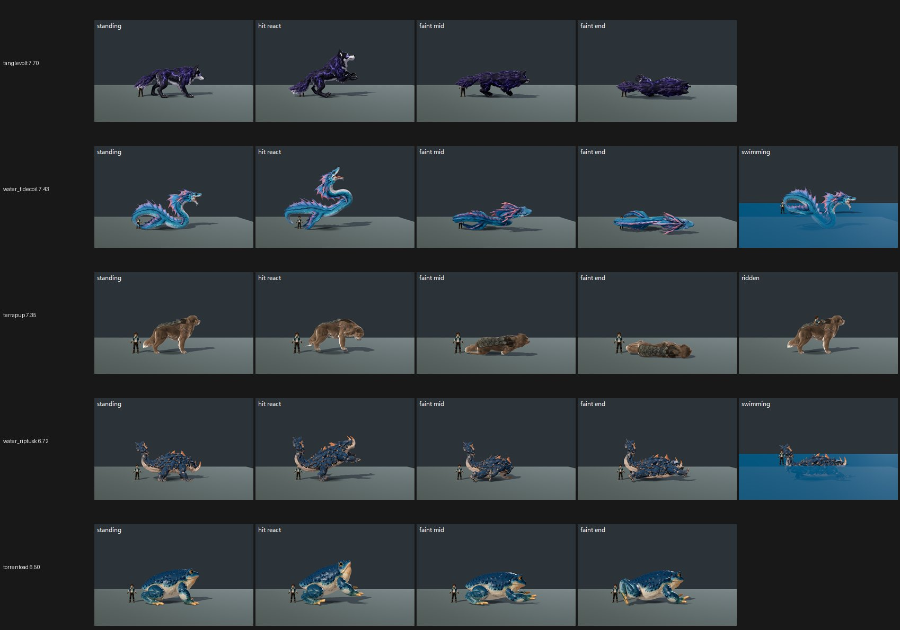

# ROSTER-1: near-bar F36 roster re-judged on main d4d5b262f at High (31 Oct 2026)

> **Update (31 Oct, Medium follow-up): Tanglevolt is MET.** Medium maps to **7.57** (judges 7.71 / 7.80 / 7.21; fit r 0.89, RMSE 0.49), and High was 7.70. Pose calls at Medium: floating faint FIXED 3/3, hit react FIXED 3/3, faint end FIXED 2 / PARTIAL 1. There is no pose PRESENT at either preset.
> - This closes Tanglevolt's F36 (1) pose row and its model row.
> - Capture: `capture_f36_poses.gd --candidate --whole-body --context --species=tanglevolt` on main d4d5b262f at Medium, one-sided, three code-blind judges, high anchors.
> - Files: `yardstick/medium-tanglevolt/`.

**Verdict: only Tanglevolt reaches 7.5 at High (7.70, no pose PRESENT), so it gets a Medium run next (queued) for its MET line. The other 19 species, plus Thundertunnel from CO12, sit at 6.50–7.43 at High and do not close.**

High only (owner, 31 Oct: judge High first and add Medium only where High ≥ 7.5). Medium is therefore "not run" for every species except Tanglevolt, whose Medium run is queued.

| Species | High (judges) | 24 Oct baseline, High | Pose calls: float / hit / upright (P = PARTIAL, F = FIXED) | Status |
|---|---|---|---|---|
| **tanglevolt** | **7.70** (7.61 / 7.80 / 7.67); Medium **7.57** | — (not in baseline) | FFF / FFP / FFF (Medium FFF / FFF / FFP) | **MET (7.70 / 7.57)** |
| water_tidecoil | 7.43 (7.51 / 7.27 / 7.51) | 7.88 | FFF / FFF / FFF | not met |
| terrapup (dog) | 7.35 (7.51 / 7.39 / 7.15) | 7.61 (badger) | FFF / FFF / FFF | not met |
| aquaryn | 7.34 (7.04 / 7.49 / 7.49) | — | FFF / FFF / FFP | not met |
| water_aquaryn | 7.31 | 7.33 | FFF / FFF / FFF | not met |
| water_sirenseal | 7.27 | 7.24 | FFF / FFF / FFF | not met |
| riverdrake | 7.23 | 7.20 | FFF / FFP / FFP | not met |
| water_riverdrake | 7.23 | 7.32 | FFF / FFP / FFP | not met |
| bramblebun | 7.19 | 7.37 | FFF / **PPP** / FFF | not met |
| burrowback | 7.17 | 7.30 | FFF / FPF / FFF | not met |
| cindercub | 7.13 | 7.18 | FFF / **PPP** / FFF | not met |
| trailpup | 7.00 | 7.34 | FFF / **PPP** / FFF | not met |
| brooktail | 6.84 | 7.13 | FFF / FFF / PFP | not met |
| sirenseal | 6.81 | 7.20 | FFF / **PPP** / PPF | not met |
| ripplet | 6.79 | 7.49 | FFF / FFP / FFF | not met |
| duskhush | 6.77 | 7.07 | FFF / **PPP** / FFF | not met |
| water_riptusk | 6.72 | 7.10 | FFF / FFF / **PPP** | not met |
| water_cannonback | 6.72 | 7.42 | FFF / **PPP** / **PPP** | not met |
| ashtusk | 6.68 | 6.36 | FFF / FFF / PPF | not met |
| torrentoad | 6.50 | 7.32 | FFF / **PPP** / **PPP** | not met |
| thundertunnel | 6.50 (from CO12 co12 arm) | — | — | not met |

**Reading the baseline column.** Fifteen of the 18 comparable species score lower than on 24 Oct (mean −0.29), and only ashtusk rises (+0.32). I read most of this as method, not art:
- **Compressed fits:** today's fits are r 0.77 and 0.75, RMSE 0.68 and 0.70, with a compressed slope of 0.63 and 0.59. That pulls every mapped score toward about 7.
- **Defect prompts:** each set now carries the three pose defects the coordinator asked for, and that makes judges look harder at poses.
- **Set layout:** the sets are one-sided at High rather than Medium-vs-High pairs.

Treat a single delta under about 0.4 as noise. Torrentoad (−0.82), water_cannonback (−0.70) and ripplet (−0.70) are the ones worth a second look; their pose calls show why (below).

**No pose PRESENT anywhere.** The floating-faint defect is FIXED 3/3 for every species, though the judges note the strips are small. The PARTIAL calls are the near-bar gap.

**Gap to 7.5 and fixes** (the judges' notes, paraphrased):
- **Hit react barely differs from standing (PARTIAL 3/3):** bramblebun (its hit react "looks airborne", a hop), cindercub, trailpup, sirenseal (its whole body leaves the floor), duskhush, torrentoad and water_cannonback. A grounded flinch, as CO12 did for Cliffspike and Voltwig, is the direct fix.
- **Faint end still upright or alert:**
  - torrentoad's faint mid and end are "the same upright crouch as standing";
  - water_riptusk keeps its head raised on an upright neck (POSE-1 targets Riptusk's faint);
  - water_cannonback;
  - brooktail and aquaryn (head lifted, PARTIAL).
- **Dark materials with no rim light:** cindercub (near-black), duskhush, and ashtusk (a near-black boar, plus a stray thin spike above the faint body). Lift the values and add a stage rim light.
- **Below trainer height:** bramblebun, trailpup, duskhush and brooktail are judged about trainer height, against the rule that creatures stand taller than the 1.80 m trainer.
- **Ripplet:** a flat, plain material; the matte coat lands, but the judges call it "well short of the owner bar".
- **Water Riverdrake / Riverdrake:** the faint crest stays erect (PARTIAL).

**Capture:**
- **Tool:** `capture_f36_poses.gd --whole-body --context`, standard roster crop, one run per species.
- **Tree and renderer:** main d4d5b262f, clean and imported, `--source-commit`, High on the GTX 1060, Forward+/Vulkan, isolated APPDATA preset.
- **Candidate flag:** `--candidate` for the 12 species in `enabled_species`; the 8 own-clip species (bramblebun, burrowback, cindercub, duskhush, ripplet, trailpup, water_cannonback, terrapup) were shot plain.
- **Result:** all 20 runs exited 0 with 4–5 poses each.
- **Thundertunnel:** not re-shot; it is taken from CO12, as asked.

**Method:**
- 20 one-sided sets in 2 batches (11 + 9), each with 4 anchor pairs, three code-blind judges per batch, high anchors.
- Fits as above, both confirming. Batch 1 carries one anchor warning (RMSE above 0.6).

`_sheet_r1.jpg` (High) shows tanglevolt 7.70, water_tidecoil 7.43, terrapup 7.35, water_riptusk 6.72 (head-up faint) and torrentoad 6.50 (upright faint, flat hit react).

`species_scores.json` holds each species' High score, judges, pose calls and baseline. The yardstick files are in `yardstick/`.
