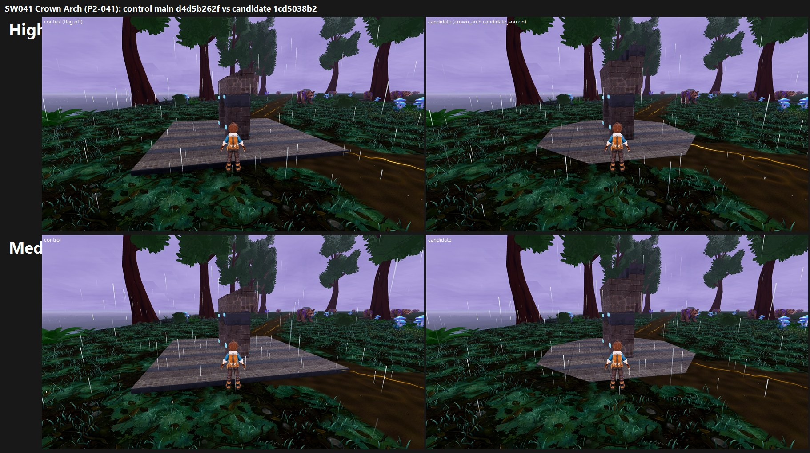

# SW-P2-041 Crown Arch on GPU: tb/sw-crownarch-on 1cd5038b2 vs main d4d5b262f (31 Oct 2026)

**Verdict: a small defect gain, not a qualifying score gain. +0.33 at both presets (4.23 → 4.56), and the catalogue defect moves from PRESENT to PARTIAL. Not met (4.56 / 4.56). Land it only as a defect fix; the arch itself needs hero art.**

| Item | Change | Medium ctl → cand | High ctl → cand | Defect ctl → cand (Medium and High alike) | MET (cand) |
|---|---|---|---|---|---|
| **P2-041** Crown Arch (F41#17) | `assets/environment/stormwood/crown_arch/candidate.json` `enabled: true` (octagonal landing, fuller crown) | 4.23 → 4.56 (+0.33) | 4.23 → 4.56 (+0.33) | PRESENT 2 / PARTIAL 1 → **PARTIAL 3** | not met (4.56 / 4.56) |

The catalogue defect reads: "The Crown Arch appears as a small square blue frame on an exposed square slab with grass clipping through it".

**Gap to 7.5: 2.94 at both presets.** All three judges name the same fixes (paraphrased from their reports):
1. **New art: a real Crown Arch hero mesh.** It should be a tall stone arch, taller than the trainer, with a crown keystone and copper, glass and lightning or crystal accents. On both arms the subject reads as "a small dark stacked block with cyan corner lights", "a small blocky stone pillar", not an arch.
2. **Set it into the terrain instead of on a slab.** On the candidate the octagonal slab is flatter and blends better, which is the whole PARTIAL gain, but it "still reads as a placeholder pad" and "an exposed slab".
3. **Frame the close view so the trainer does not hide it.** The trainer stands in front of the arch in the job's close frame, on both arms.

None of the three could confirm the grass clipping at the judged size.

**Capture:**
- **Frames:** P2-041's one job.json frame (`stormwood__landmark__crown_arch__day__close`), from its repro command `phase2_capture_locations.gd --subset=stormwood__landmark__crown_arch --times=day --views=close --seed=2042`.
- **Arms:** each arm at its own 40-hex SHA on a clean, imported tree (control d4d5b262f, candidate 1cd5038b2). The candidate is main plus that one flag.
- **Renderer and settings:** Medium and High on the GTX 1060, Forward+/Vulkan, isolated APPDATA preset. Each command ran with `--fullscreen`, `--source-commit=<sha>` and `--preset=<preset>`.
  - Each manifest's `graphics_capture` block records the preset, `forward_plus`, the adapter and the source commit.
- **Result:** four runs, all exit 0, one frame each.
- **Caveat:** the subject is a single close frame. Medium and High render this view nearly identically, so the two presets scored the same.

**Method:**
- Two two-sided sets (one per preset, candidate vs control), three code-blind judges, high anchors.
- Fit r 0.90, RMSE 0.52, confirming.

`_sheet_sw041.jpg`: top row High, bottom row Medium; control left, candidate right.

**What the judges saw (paraphrased):**
- **Control:** the arch sits on "a raised, dark-edged square slab" with visible thickness. Two judges call the defect PRESENT and one PARTIAL.
- **Candidate:** "a flatter hexagon/octagon set more flush with the ground"; all three call it PARTIAL.
- **Both:** the arch block itself is unchanged and is mostly hidden behind the trainer. The Stormwood purple sky, rain and moss match the board, but the horizon is an empty grey line.

The yardstick files are in `yardstick/`: candidates, key, mapped, j1–j3 and sets. Set codes are Ot (Medium) and Ac (High); side A = control, side B = candidate.
