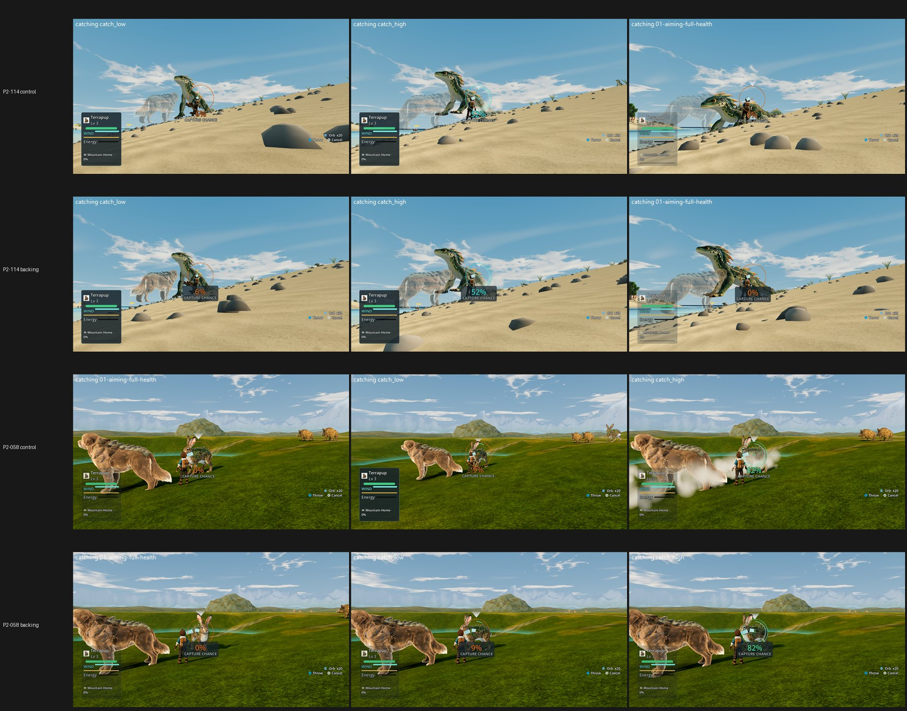

# UI-1: capture readout backing as a flag flip at High (31 Oct 2026)

**Verdict: land it. P2-114 +0.57 (qualifying) and P2-058 +0.47. The capture-chance defect goes from PRESENT 3/3 to mostly FIXED or PARTIAL on both. The plate draws on Forward+, which the coordinator wanted confirmed. P2-059 and P2-061 are unchanged, because they are camera and result-text items the plate does not touch. Nothing reaches 7.5, so no Medium run is due.**

| Item | High control → backing | Defect (control → backing) | MET |
|---|---|---|---|
| **P2-114** Tidewake catch chance (F39#23) | 5.55 → **6.12 (+0.57)** | label over the trainer and pale sand: PRESENT 3 → **PARTIAL 1 / FIXED 2** | not met |
| **P2-058** Meadows catch aim | 5.77 → 6.24 (+0.47) | chance and reticle on the target over busy grass: PRESENT 3 → PARTIAL 3 | not met |
| P2-059 catch camera | 5.58 → 5.55 (−0.03) | wide aim → tight downward strike shot: PRESENT 3 → PRESENT 3 | not met |
| P2-061 catch result text | 5.68 → 5.68 | result text vs persistent creature cards: PRESENT 3 → PRESENT 3 | not met |

**Does the plate draw?** Yes. On the candidate, every capture-chance frame shows one dark rounded plate behind the percentage and the "CAPTURE CHANCE" caption (6%, 52%, 0% in Tidewake; 0%, 9%, 82% in Meadows). All three judges read the percentages as clear on the plated side.

**Gap to 7.5 and fixes** (the judges, paraphrased):
- **P2-114 and P2-058:** keep the plate, and move the readout off the target. It still sits on the creature and reticle (the P2-058 PARTIAL calls).
  - P2-058's control also has white smoke puffs crossing the readout in catch_high.
  - In Tidewake the companion renders as a see-through ghost over the target, and the rocks are evenly scattered blobs.
- **P2-059:** keep a wide camera that holds the trainer, companion and target together. Today the strike and absorb frames crop to a sliver of the companion.
- **P2-061:** hide the creature cards and action list during the result, tone down the orb bloom, and show one large outcome banner on a plate. The breakout frame's bottom prompt overlaps itself.
- **Meadows catch field:** a flat grass carpet. Groves, rocks, flowers and a warm grade with haze would lift every Meadows catch frame.

**Capture:**
- **Tree:** one imported tree, local 402a80f3a (main d4d5b262f + tb/dialogue-cam + tb/ui-near-bar e07666f35 + tb/craft-r3, all flags off).
- **Arms:**
  - Control = that tree.
  - Candidate = the same tree with `data/config/capture_readout_visual.json` copied byte for byte from tb/ui-near-bar-on e0f51545d (`backing_enabled: true`; sha256 e34789f64654, receipt in `flips.jsonl`).
- **Frames:** P2-114, P2-058, P2-059 and P2-061's catching frames from job.json. They come from one `phase2_capture_catch.gd --seed=2042` run per biome per arm; the identical commands were shot once and their frames copied.
- **Settings:** High, Forward+, GTX 1060, `--fullscreen`, `--source-commit`, `--preset=High`.
- **Retry:** the Tidewake control run hung once (watchdog) and passed on retry.
- **Caveat:** the catch scene is not pixel-identical between runs. Rock layout and creature position shift between arms, so only the readout is a like-for-like comparison. The scenery differences are run-to-run, not from the flag.

**Method:**
- Four two-sided sets (backing vs control) plus 4 anchor pairs, three code-blind judges, high anchors.
- Fit r 0.90, RMSE 0.50, confirming.
- Set codes: Dn P2-114, Sr P2-058, Dc P2-059, Qz P2-061. Sides are shuffled; see `key.json`.

`_sheet_ui1.jpg`: P2-114 and P2-058, each as control then backing. The backing rows show the dark plate behind the percentage.
