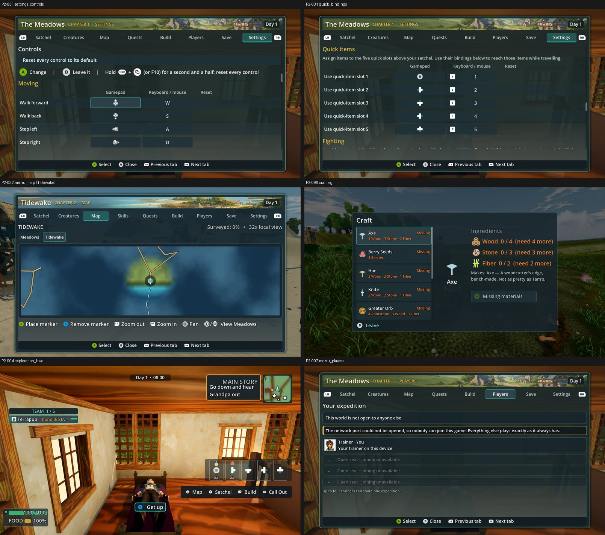

# UI-PAD: the menus with controller glyphs (`--gamepad`) on main d4d5b262f, High (31 Oct 2026)

**Verdict: with a pad connected, the six UI items score 6.12–6.84 at High. None reaches 7.5, so no Medium run is due (owner, High first). Controller glyphs remove the bracketed key labels, but the judges' remaining issues are layout and finish, not glyphs.**

| Item | Pad, High (judges) | Keyboard, 28 Oct item scores* | Defect, pad (keyboard) | MET |
|---|---|---|---|---|
| **P2-001** menu shell | **6.84** (6.75 / 6.93 / 6.84) | 6.58 | PARTIAL 3 (PARTIAL 3) | not met |
| **P2-096** craft confirm glyph | 6.66 (6.66 ×3) | 6.86 | PARTIAL 3 (PARTIAL 3) | not met |
| **P2-032** map: keys mixed with buttons | 6.48 (6.66 / 6.12 / 6.66) | 6.36 | FIXED 3 (FIXED 3) | not met |
| **P2-004** exploration HUD | 6.45 (6.66 / 6.03 / 6.66) | 5.56 | PARTIAL 3 (PARTIAL 3) | not met |
| **P2-007** secondary panels | 6.24 (6.21 / 6.21 / 6.30) | 6.40 | PARTIAL 3 (PARTIAL 2 / PRESENT 1) | not met |
| **P2-031** "[Q] Previous tab [Tab] Next tab" | 6.12 (6.12 / 6.21 / 6.03) | 6.32 | PARTIAL 2 / PRESENT 1 (**PRESENT 3**) | not met |

*The keyboard column comes from the 28 Oct per-item batch on the default Compatibility renderer. It is a different batch and renderer, so read the differences as ±0.3 noise, except P2-004 (+0.89).

**What the pad changes:**
- The tab bar now shows LB/RB glyphs and the hint rows show A, B and stick icons, so P2-031's bracketed key labels are gone on the pad path. That moves P2-031's defect from PRESENT to mostly PARTIAL.
- The keyboard path's bracket labels remain a known keyboard defect. This score does not replace that one.

**Gap to 7.5 and fixes** (judges, paraphrased; they agree across items):
1. **Text size and contrast for a 7-inch screen (all six):** the secondary and instruction text is tiny and grey.
   - **P2-031** still shows the keyboard column (W/S/A/D, 1–5) beside the gamepad column.
   - **P2-096**'s main action is a dim grey "Missing materials" button. CRAFT-R3, job 13, targets this.
2. **Fill or collapse the sparse panels (P2-007):** Players is mostly greyed empty seat rows, and the quest log uses about half its height.
3. **HUD consolidation (P2-004):** six separate dark boxes plus a quick-slot row and a prompt bar. Merge them into fewer panels at the screen edges.
4. **Map art (P2-032):** the right tab is now active, but the map itself is "a blurry blue field".
5. **Menu body (P2-001):** the painted Meadows header strip helps, but the body is uniform dark boxes.

**Capture:**
- **Commands:** P2-031, P2-032, P2-096, P2-001, P2-007 and P2-004's job.json repro commands, three in total: `phase2_capture_ui.gd` (Meadows), `phase2_capture_ui.gd --biome=water` and `phase2_capture_build_systems.gd`.
- **Tree:** main d4d5b262f on a clean, imported tree.
- **Flags:** each command ran with `--gamepad`, `--fullscreen`, `--source-commit` and `--preset`.
- **Renderer:** GTX 1060, Forward+/Vulkan.
- **Presets:** UI-PAD had already started at Medium when the owner's High-first direction arrived, so both presets were captured. Only **High** is judged, and the Medium frames are kept.
- **One retry:** the Tidewake UI command at High hung once, the watchdog stopped it after 30 min, and the retry finished in 62 s with all 12 frames.

**Method:**
- Six one-sided sets (High) plus 4 anchor pairs, three code-blind judges, high anchors.
- Fit r 0.96, RMSE 0.25, confirming.
- Set codes: Ci P2-001, Qb P2-096, Ns P2-032, Zb P2-004, Eb P2-007, Zv P2-031.

`_sheet_uipad.jpg`: the pad frames at High.
- P2-031: controls with gamepad glyphs, and quick bindings.
- P2-032: the Tidewake map.
- P2-096: crafting.
- P2-004: exploration HUD.
- P2-007: players.
