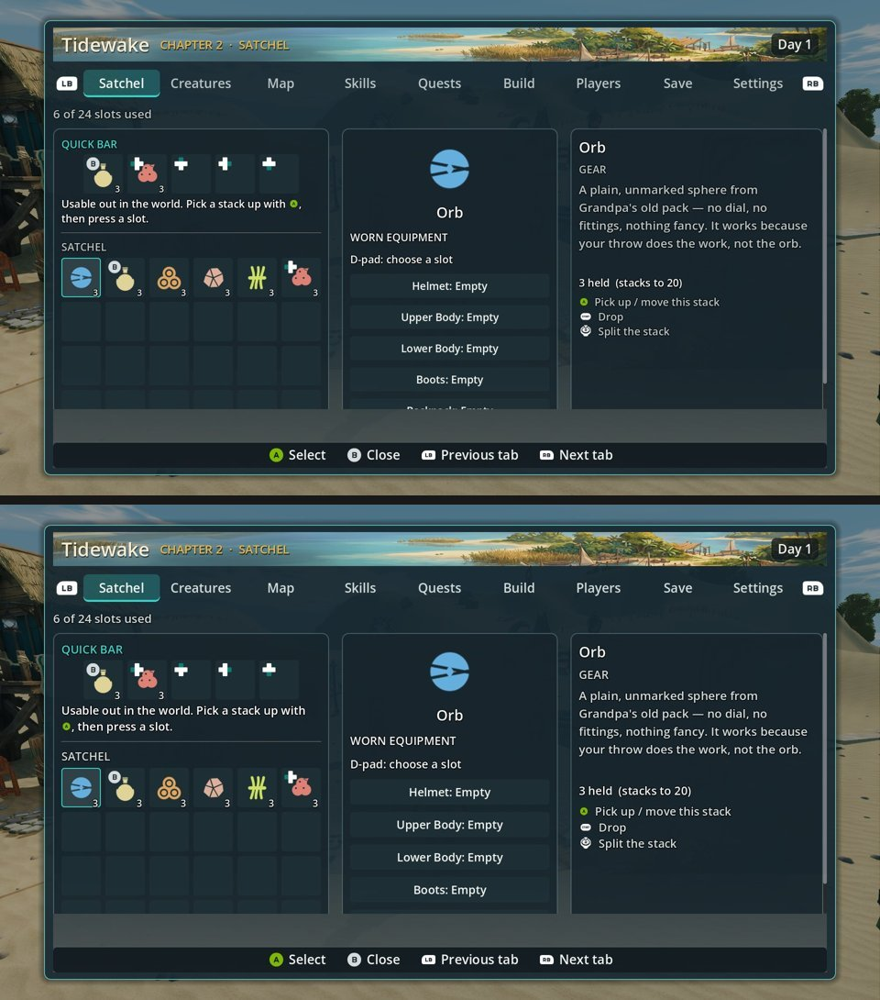

# UI-R2: brighter, larger secondary text (ui_tokens.gd) on the UI-PAD frames, High, --gamepad (31 Oct 2026)

**Verdict: no effect on these items. Don't count it toward them: five items are identical and P2-001 is +0.03. The token change barely reaches the scored screens: most of the game-menu tabs don't draw with these tokens. One overflow on the backpack screen. Nothing reaches 7.5.**

| Item | High control → UI-R2 | Defect (control → UI-R2) |
|---|---|---|
| P2-096 craft hints | 7.15 → 7.15 | PARTIAL 3 → PARTIAL 3 |
| P2-001 menu shell | 6.57 → 6.60 (+0.03) | PARTIAL 3 → PARTIAL 3 |
| P2-032 map | 6.48 → 6.48 | FIXED 3 → FIXED 3 |
| P2-004 exploration HUD | 6.41 → 6.41 | PRESENT 2 / PARTIAL 1 (both) |
| P2-007 secondary panels | 6.26 → 6.26 | PRESENT 2 / PARTIAL 1 (both) |
| P2-031 controls / bindings | 5.93 → 5.93 | PRESENT 3 → PRESENT 3 |

**Why nothing moved:**
- **Pixel differences:** the Tidewake menu frames, which have a static background, differ between arms by 0.1–0.3 (mean absolute luma), which is identical within noise. The exception is the backpack tab (4.1).
- **The backpack tab shows the change:** brighter, slightly larger description and secondary text, and the quick-bar hint wraps differently.
- **Where the tokens are used:** `TEXT_SECONDARY`, `TEXT_MUTED`, `FONT_TINY` and `FONT_LABEL` are read by HUD widgets, `craft_panel.gd`, `build_menu.gd`, `minimap.gd`, `party_strip.gd` and the combat overlays.
- **Where they are not:** the game-menu tab scripts set their own sizes. `tab_settings.gd` has 10 hardcoded `add_theme_font_size_override` sizes, and `tab_skills.gd` and `tab_backpack.gd` have others. The judges' "bigger, brighter secondary text" therefore needs those tab scripts, and the shared menu theme, to read the tokens.

**Clipped or overflowing text (asked for):**
- **Backpack (Satchel) tab, both biomes:** the fifth worn-equipment row ("Backpack: Empty") is already half-cut at the bottom of the centre panel on the control. With UI-R2's larger label it is pushed fully out of the panel. The list needs to scroll or compact.
- **P2-031, both arms:** all three judges note that the quick-bindings "Fighting" section is cut off at the bottom of the panel. This is not caused by UI-R2.
- I saw no other new clipping.

**Capture:**
- **Tree:** one imported tree, local 402a80f3a.
- **Arms:**
  - Control = that tree.
  - Candidate = the same tree with `scripts/ui/ui_tokens.gd` copied byte for byte from tb/ui-r2-on f6ee5c6d5 (sha256 4a8148c1c639, receipt in `flips.jsonl`; a script, read at runtime).
- **Commands:** the UI-PAD items' job.json commands with `--gamepad`: `phase2_capture_ui.gd` for Meadows and water, and `phase2_capture_build_systems.gd`.
- **Settings and result:** High, Forward+, `--source-commit`, `--preset=High`. All six runs passed first try.

**Method:**
- Six two-sided sets plus 4 anchor pairs, three code-blind judges, high anchors.
- Fit r 0.84, RMSE 0.57, confirming.

`_sheet_uir2_backpack.jpg`: Tidewake Satchel tab, control (top) vs UI-R2 (bottom). Brighter, larger secondary text; the "Backpack: Empty" row is pushed out of the centre panel.
