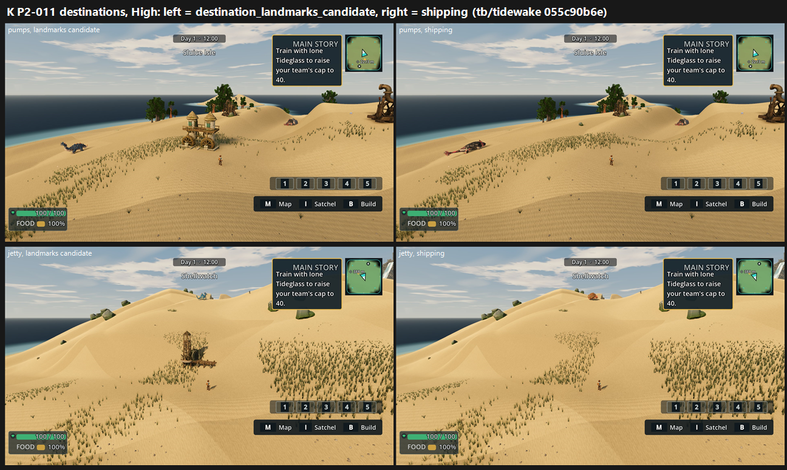

# K: P2-011 destination landmarks on GPU, tb/tidewake 055c90b6e (25 Oct 2026)

**Verdict: a clear lift (+1.0 to +1.3), but still below 6.**
- **Destination defect** ("named destination reads as an unmarked slope or generic structure"): PRESENT → **PARTIAL**, 12 of 12 calls (3 judges × 4 sets).
- **Tier: below 6.** The candidate's lowest view is 5.58.

| View | Candidate (`destination_landmarks_candidate`) | Shipping | Δ |
|---|---|---|---|
| Sluice twin pumps, Medium | **5.79** | 4.77 | +1.02 |
| Sluice twin pumps, High | **5.79** | 4.51 | +1.28 |
| Shellwatch rescue jetty, Medium | **5.58** | 4.47 | +1.11 |
| Shellwatch rescue jetty, High | **5.58** | 4.47 | +1.11 |

The GPU confirms the CPU lm1 round's direction (4.33 → 5.58).

`_sheet_k.png` (1.34 MB), at High: the candidate on the left, shipping on the right.

## What the judges saw (all three)

- **Each destination is now marked:** a twin-turret wheel house at Sluice Isle and a wooden lookout at Shellwatch.
- **Both are small:** about 2 trainers tall.
- **Both stand on dry dune, away from the water.** The pumps tie to no channel, and the jetty is inland on its hilltop point.
- **The coast around them is unfinished:** an even grass carpet, a flat navy sea, no shallows or foam, and flat midday light.
- **Possible oxblood:** a dark-red creature lies on its side in the pumps view at High, shipping arm (3/3 noticed it). That is ambient wildlife, not the landmark, but the colour is close to the Team Tether reserve.

## Run

- **Source:** `tb/tidewake` 055c90b6e (the branch head), verified.
- **Arms:**
  - Shipping: no look sections, so the candidates are OFF as in play.
  - Candidate: `--tidewake-look-sections=destination_landmarks_candidate`.
- **Capture:** `capture_tidewake_f13_5.gd --camera-set=res://tools/visual_judge/camera_sets/P2-011-destinations.json --source-sha=<head> --capture-size=1920x1080 --preset=
`, Forward+ on a GTX 1060.

## Yardstick

- **Sets:** 4 (2 views × 2 presets), candidate vs shipping, with 4 anchor pairs.
- **Judges:** three fresh code-blind judges.
- **Fit:** slope 1.274, intercept −0.029, r 0.91, RMSE 0.50, confirming.

## Path to 7.5

The gap is about 1.9.

1. **Seat each landmark at the water** (*scene*, placement). Put the jetty on the nearest shoreline with its deck over the water, and put the pumps at a channel edge with a spill. This is lm1's own next step and needs a shoreline probe.
2. **Scale up 1.5–2x** so each reads at 4–5 trainers.
3. **Dress the coast around them** (*scene*): cyan shallows and foam at the shore, wet-sand edge, grass in clumps and edges, and grouped rocks and driftwood.
4. **Inhabit them:** a boat at the jetty and a keeper or villager at each.

## Files

- `_sheet_k.png`, `build_yard_KL.ps1.txt`.
- `yardstick/`:
  - `key.json`, `sets.md`, `candidates.json`, `recorded_defects.txt`, `judge_prompt_filled.txt`;
  - `j1`–`j3`;
  - `batch.json`, `mapped.json`.
