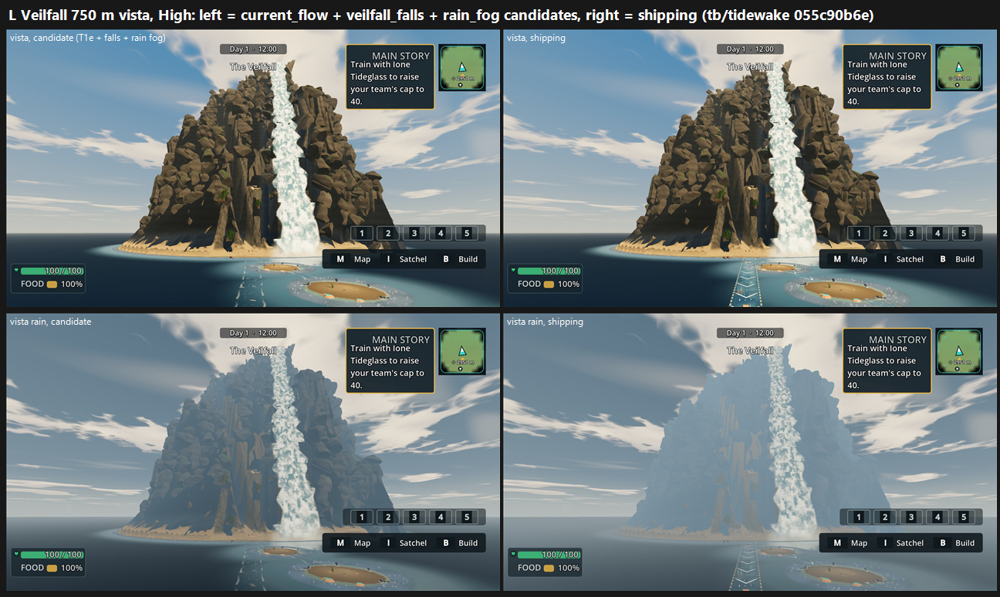

# L: Veilfall on the 750 m vista stand on GPU, tb/tidewake 055c90b6e (25 Oct 2026)

**Verdict: the candidate lifts both views (+0.42 clear, +0.63 rain), but the mountain itself holds the row below 6.**

This also **re-takes the GPU Veilfall baseline** on the new stand: shipping scores **5.23 clear / 4.81 rain**. The old 3.20 was on the cropped 200 m stand, so the two are not comparable.

| View | Candidate (current_flow + veilfall_falls + rain_fog) | Shipping | Δ |
|---|---|---|---|
| veilfall-vista (clear), Medium = High | **5.65** | 5.23 | +0.42 |
| veilfall-vista-rain, Medium = High | **5.44** | 4.81 | +0.63 |

- **Tier: below 6.** The candidate's lower view is 5.44.
- **Medium and High scored identically:** each preset pair was judged as separate sets and got the same calls.

| Recorded defect | Candidate | Shipping |
|---|---|---|
| Veilfall a smooth cone with thin falls, not a stepped, inhabited mountain | PARTIAL (two judges) / PRESENT (one), both arms | same |
| Currents: oversized opaque chevrons and dashed lines | **PARTIAL 12/12** (a softer foam lane) | **PRESENT 12/12** |
| Rain view without rain or fog that reads | PARTIAL 6/6 on the rain views | PARTIAL 4 / FIXED 2 |

**Notes:**
- The rain defect also got votes on the clear views. Two judges noted that it doesn't apply there, so only the rain-view calls are counted.
- **The fog trade-off:** shipping's rain view is a heavy flat blue fog. One judge counts that as weather that reads (FIXED), but all three say it "swallows the mountain into one mid-tone". The candidate's grey overcast keeps the mountain's values and wins on Bar A, but shows no falling rain or spray.

`_sheet_l.png` (1.23 MB), at High: the candidate on the left, shipping on the right; clear on top, rain below.

## What holds it below 6 (all three judges)

- **The mountain:** "a cone of faceted brown boulders with one broad fall", with no terraces, green ledges, arches or settlement. The nv1 CPU round reached the same conclusion: the fix is terraced cliff tiers and stepped falls down the whole face, not only a summit crown.
- **No falling rain:** no rain streaks, falls spray or wet sea in either arm.
- **HUD over the landmark:** the quest panel and the "The Veilfall" label crowd the summit, and the hotbar sits over the island base. That is a capture framing issue for this stand.

## Run

- **Source:** `tb/tidewake` 055c90b6e, verified.
- **Arms:**
  - Shipping: no look sections.
  - Candidate: `--tidewake-look-sections=current_flow,veilfall_falls_candidate,rain_fog_candidate` (T1e plus falls plus rain fog; the crown is not included).
- **Capture:** `capture_tidewake_f13_5.gd --camera-set=res://tools/visual_judge/camera_sets/F39-look.json --views=veilfall-vista,veilfall-vista-rain --source-sha=<head> --capture-size=1920x1080 --preset=
`, Forward+ on a GTX 1060.

## Yardstick

- **Sets:** 4 (2 views × 2 presets), with 4 anchor pairs.
- **Judges:** three fresh code-blind judges.
- **Fit:** slope 1.057, intercept 0.932, **r 0.95**, RMSE 0.40, confirming.

## Path to 7.5

The gap is 2.06 on the rain view.

1. **Rebuild the mountain's face** (*new_art*): pale stratified cliff tiers with tree-topped green ledges, several falls stepping tier to tier with mist at the base, and visible stronghold architecture (arch, bridge, gate behind the main fall). This is nv1's conclusion, now confirmed on GPU.
2. **Make rain fall** (*scene*): rain streaks, sea-surface splashes and falls spray, with distance fog that keeps the mountain's value structure. Keep the candidate's grey overcast as the base grade.
3. **Keep T1e:** soft foam lanes, no chevrons, in every weather.
4. **Frame the vista without HUD over the landmark:** hide the quest panel and label for catalog captures, or move the stand.

## Files

- `_sheet_l.png`, `build_yard_KL.ps1.txt`.
- `yardstick/`:
  - `key.json`, `sets.md`, `candidates.json`, `recorded_defects.txt`, `judge_prompt_filled.txt`;
  - `j1`–`j3`;
  - `batch.json`, `mapped.json`.
