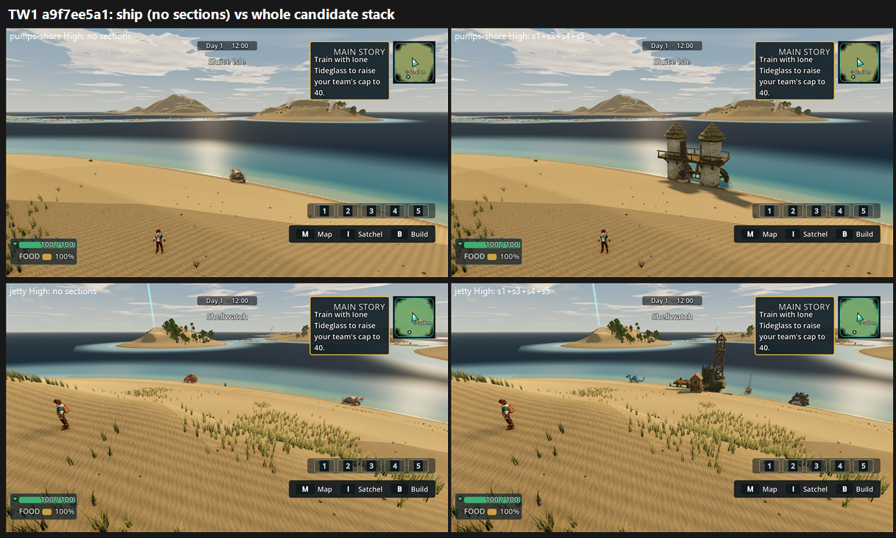

# TW1: Tidewake P2-011 destinations on GPU, a9f7ee5a1, whole candidate stack (s1+s3+s4+s5) vs no sections (26 Oct 2026)

**Verdict: land it.** The mean gain is **+1.24**, well over the +0.5 bar.
- **pumps-shore:** 5.35 → **6.68 (+1.33)** at both presets.
- **jetty:** 5.41 → **6.56 (+1.15)** at both presets.
- **P2-011** ("named destinations read as unmarked grassy slopes or small generic structures"):
  - pumps-shore: PRESENT 3/3 → **PARTIAL 2 / FIXED 1**.
  - jetty: PRESENT 3/3 → **PARTIAL 3/3**.
- **Tier 6–7, not met.** Lower preset 6.56 (jetty), so about 0.9 short. pumps-shore is 6.68 / 6.68 and the jetty 6.56 / 6.56; both not met.

| View | Medium off → on | High off → on | P2-011 | Clipping | Placeholder / floating | MET |
|---|---|---|---|---|---|---|
| pumps-shore | 5.35 → **6.68 (+1.33)** | 5.35 → **6.68 (+1.33)** | PRESENT 3 → PARTIAL 2 / FIXED 1 | FIXED 3 → PARTIAL 1 / FIXED 2 (a wild creature at the tower foot) | FIXED 3/3 on both | not met (6.68 / 6.68) |
| jetty | 5.41 → **6.56 (+1.15)** | 5.41 → **6.56 (+1.15)** | PRESENT 3 → PARTIAL 3 | FIXED 3/3 on both | FIXED 3/3 on both | not met (6.56 / 6.56) |

**Method:**
- **Capture:** one commit (a9f7ee5a1), verified checkout. `capture_tidewake_f13_5.gd` with the `P2-011-destinations.json` camera set, views pumps-shore and jetty, noon clear, 1920x1080, Medium and High.
- **Arms:** the ship arm has no look sections. The candidate arm adds `--tidewake-look-sections=destination_landmarks_candidate,_s3_,_s4_,_s5_`.
- **Run note:** all 4 runs reported "CAPTURE OK views=2". The runner logged `frames=0` only because it counts `.png` and this tool writes `.jpg`.
- **Sets:** one set per view per preset, one full frame per side (HUD on screen on both arms). 4 sets in one batch, with three code-blind judges and high anchors. Fit r 0.87, RMSE 0.57, confirming.

**Caveats:**
- **Single shot per destination:** each destination is one camera at noon, clear weather, so there is no night, rain or second angle.
- **Medium = High:** the judges scored the two presets identically.
- **Wild creatures:** they spawn differently in each capture. The judges were told to ignore them, but one judge still calls clipping PARTIAL where a wild creature stands at the pump tower's foot. That's a spawn position, not landmark geometry.
- **Judge 3 re-run:** judge 3 first left two of the four Tidewake sets (Uo, Ug) out of its file. It re-viewed them and rewrote the file once with all sets, and its other entries did not change. Its Ug and Uo scores match its own twin sets (Wj, Uw).

`_sheet_tw1.png`, High: no sections on the left, the whole stack on the right. Top row is pumps-shore (Sluice Isle), bottom row is the jetty (below Shellwatch).

## What the judges saw

- **On:**
  - **pumps-shore:** "twin thatched pump towers give a real landmark".
  - **jetty:** the "lattice watch-derrick is a navigable silhouette", with a shack, dock and moored boat.
- **Off:** an empty beach with nothing to navigate by (P2-011 PRESENT 3/3 at both views).
- **What remains on the on arm:**
  - **Bare foreground:** "an empty sand sheet, evenly sprinkled grass tufts", and "half of each frame is bare rippled sand under flat light" (all 3).
  - **The jetty reads small:** the cluster "is small and far" (all 3).
  - **Water:** "a hard navy water band" or "a smeared dark band across the water" in the mid-distance (all 3).
  - **Far islands:** "bare cone islands", with none of the cliffs and white falls on the Veilfall board.
  - **Light:** a flat noon grade with no haze, spray or surf. One judge reads the tower's long shadow as mid-afternoon.

## Path to 7.5 (jetty 6.56 and pumps-shore 6.68, about 0.8–0.9 short)

1. **Dress each destination around its landmark** (*scene*): rocks, driftwood, nets, crates, pier and pipe runs or sluice channels, and a worn path leading to the structure. Replace the even grass-tuft scatter with grouped dune grass at the edges. All 3 judges name this first.
2. **Make the jetty read from its camera** (*scene*): scale up the derrick or bring the camera closer, so the landmark isn't a small, distant cluster.
3. **Water and light** (*scene*): remove the dark mid-water band, add white surf at the waterline and haze on the far islands, and light for a true noon.
4. **Distance language and hero scale** (*new_art*): cliff-and-falls islands or rock headlands instead of bare sand cones (1 judge). Another judge asks for each destination's landmark at the Veilfall board's scale: arches, terraces, sluice gates or a tall beacon.

## Files

- `_sheet_tw1.png`, `build_yard_TW1.ps1.txt`.
- `yardstick/TW1_rows.json`, `yardstick/coverage.json`.
- `yardstick/TW1b1/`: `key`, `sets.md`, `candidates`, `j1`–`j3`, `batch`, `mapped`.
