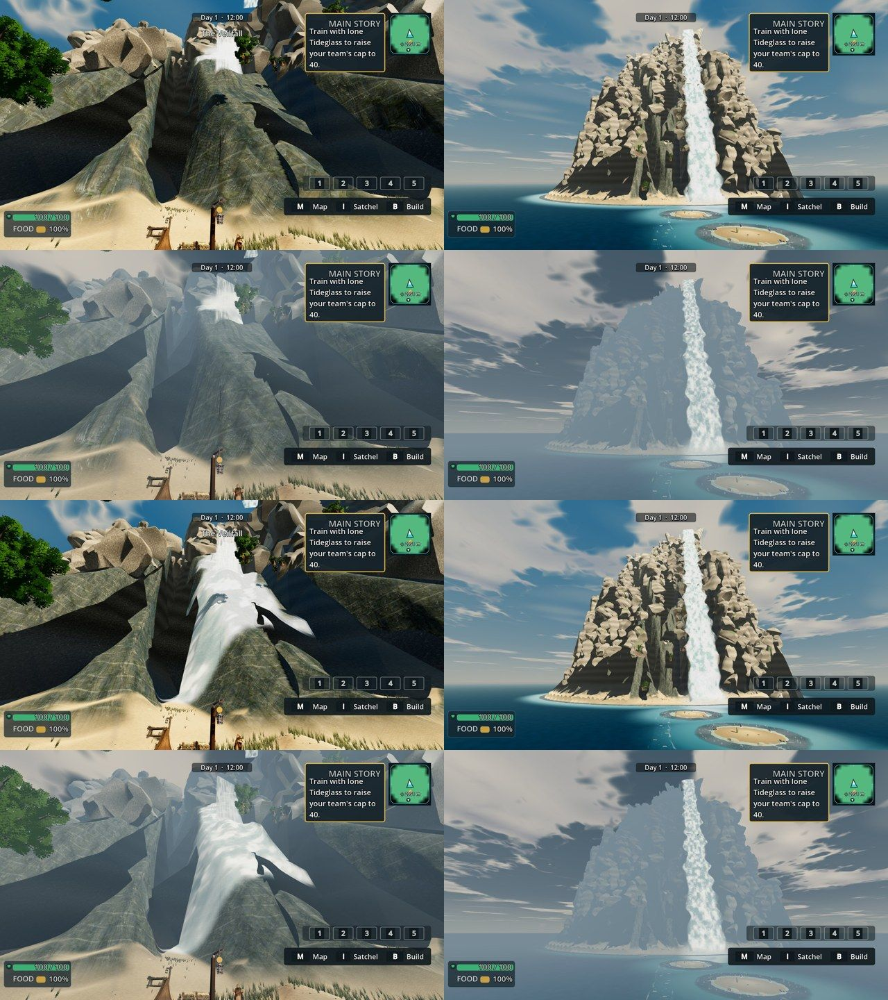

# VIS-TIDEWAKE look round 3: Veilfall near sections (CPU)

- Capture: `capture_tidewake_f13_5.gd`, camera sets F39-look (11 views) and T2-current (3 of 4 views; swim-brine-day "missed the authored current" on both arms). CPU llvmpipe, Compatibility, Low, 1920x1080. Base and candidate on the same tree (`runbook/round3.sh`).
- Candidate: `tidewake_look.json` sections_off minus `veilfall_rock_detail_candidate`, `veilfall_formation_relief_candidate`, `veilfall_falls_candidate`.
- Yardstick: JUDGE_PROMPT.md verbatim, 3 anchor pairs (`anchor_tiles.py --include craft --seed 1104`), three fresh code-blind judges in one message, `calibrate.py`: linear, slope 1.309, r 0.965, anchor RMSE 0.23.

| Row | Subject | Base (mapped) | Candidate (mapped) | Gain |
|---|---|---|---|---|
| F39#31 | Veilfall at distance and up close | 4.94 | **5.20** | +0.26 |
| F39#30a (F39#30/#32) | shore day, golden, lesson dune, rain | 5.63 | 5.63 | 0.00 |
| F39#30b (F39#30/#32) | night, dawn, lesson rain, Veilfall approach | 5.11 | 5.11 | 0.00 |
| F13#5 | currents at the normal camera, Veilfall at distance | 5.68 | 5.72 | +0.04 |

The candidate ships ON (owner rule 4 Nov: a judged gain ships).

Judges' remaining asks:
- Veilfall:
  - the up-close fall sheet is opaque and paper-flat, with a dark notch or tear (3/3);
  - the gully walls are still stretched green-grey wedges;
  - at distance it is a single bare boulder cone with one fall, without tiers, greenery or the arch (new art).
- Night and rain:
  - night is a black void with no moon or stars;
  - the rain frame reads as flat noon.
- Currents: they are now short, evenly scattered crescents rather than lanes (PARTIAL 3/3); judges ask for flow-aligned foam.

 F39#31 base (top) and candidate (bottom).
