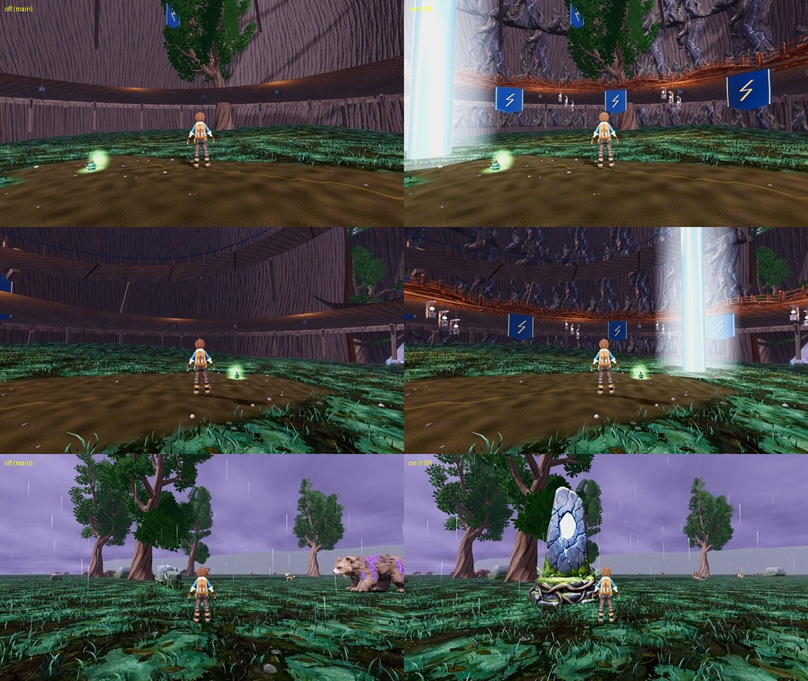

# r19 (25 Oct): Stormheart hero interior and heartstone framing, code-blind CPU

Arms: main look (lane tree, every r19 flag OFF) vs the r19 overlay: `stormheart_presentation.json hero_interior.enabled`, `stormwood_surge.json presentation.steam.lens_fade_m` [3, 7], and for the heartstone `stormwood_heartstone_visual.json hero.enabled` (7 m, 1.6 m collider) seen from the r19 stand. CPU Compatibility 1280x720, calm, `capture_stormwood_f10_matrix.gd --custom` at the F41 catalogue headings.
- Stormheart: catalogue stand (-101.56, 5466.87), views v02 (heading -63.4) and v04 (56.6), stacked.
- Heartstone off: today's `f41_survey` stand (691.5, 2703.5) heading 27, hero OFF. On: (696.11, 2708.11) heading 20 (5.5 m south-west of the stone, which sits 25 degrees right of the view), hero ON.

Yardstick: JUDGE_PROMPT v1, 3 fresh judges, 3 anchor pairs (craft, f36_0_npc, f04_6_r22), seed 1919. calibrate.py linear slope 1.256, intercept -1.109, r 0.86, anchor RMSE 0.42, confirming batch. Warning: the OFF arms extrapolate below the anchors' range.

| Item | off (mapped) | on (mapped) | gain | judges (raw, on) |
|---|---|---|---|---|
| Stormheart interior | 3.79 | 5.80 | +2.01 | 5.6 / 5.5 / 5.4 |
| Crown heartstone | 3.96 | 5.63 | +1.67 | 5.5 / 5.1 / 5.5 |

Defects (on): smooth walls FIXED 2/3, PARTIAL 1/3; no lightning core FIXED 3/3; dark monochrome PARTIAL 3/3. Heartstone presence FIXED 3/3; creatures crowding FIXED 3/3; flat grey horizon PRESENT 3/3.

What still holds them down (all three): the core reads as a bloomed light pillar, not arcing lightning; the hollow floor is a dirt disc in a grass ring ("arena, not a living trunk"); lower walls still plank under the deck; the Stormwood flat grey horizon band and uniform grass carpet (gap 1).

Build notes: the first core (2.6 m white emissive core in a rim-lit sheath) clamped to a flat white slab inside a glass tube; the second (2 m blue body) read as a flat tube. The judged core is 1.1 m with drifting white filaments in a centre-weighted additive halo. The heartstone at 4 m from 5.5 m was about 15% of frame height; 7 m is about a third.

