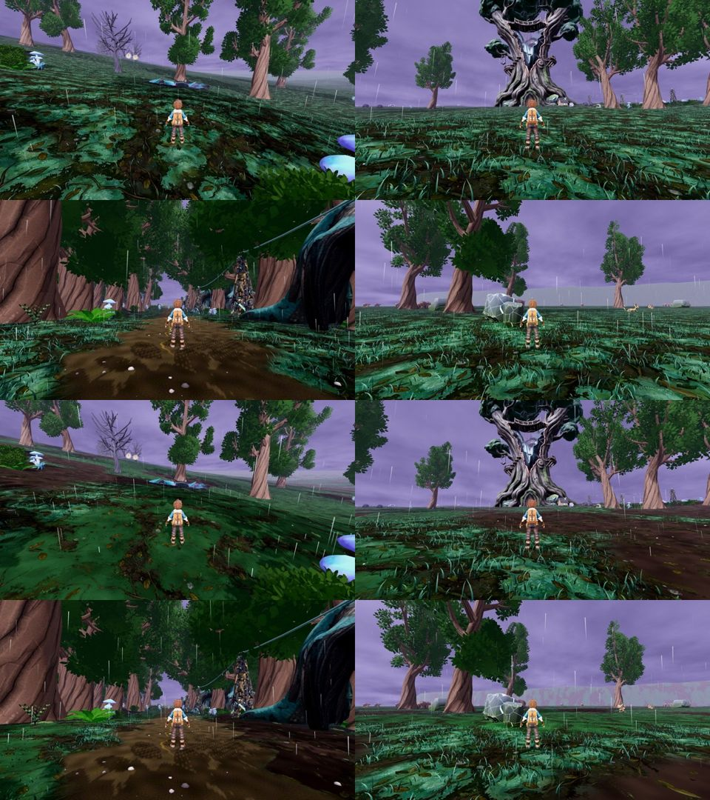

# r20 (25 Oct): authored ground zones, code-blind CPU

Arms: lane tree with `stormwood_ground_finish.json ground_zones` OFF vs ON (scale 0.055, bare [0.40, 0.46], moss [0.54, 0.60], loam #2b241c, moss #24381f, far sheet opened over loam). Four calm stands, 2x2 per side: glass (matrix), stormheart approach (matrix), rod_line (matrix), crown heartstone (r19 stand, hero OFF). The forest and giant stands were left out: their ground is the cover tiers, which the zones do not touch.

Yardstick: JUDGE_PROMPT v1, 3 fresh judges, 3 anchor pairs (craft, f36_0_npc C7, f36_0_gap C3), seed 2020. calibrate.py linear slope 1.472, intercept -2.353, r 0.996, anchor RMSE 0.08, no warnings.

| Item | off (mapped) | on (mapped) | gain | judges (raw off -> on) |
|---|---|---|---|---|
| Stormwood ground (4 stands) | 4.76 | 5.30 | +0.54 | 4.9->5.3, 5.0->5.3, 4.6->5.0 |

Carpet defect: PRESENT 2/3, PARTIAL 1/3 -> PARTIAL 3/3. Flat grey horizon PRESENT 3/3 on both.

Not GPU-ready as judged: all three judges read the loam as dark red-brown, near maroon (oxblood is Team Tether's) with hard decal-like edges, no judge saw a moss zone, and the opened far sheet showed the fogged terrain as a pink-magenta strip on the crown-hollow horizon. Their asks: cool umber soil, soft edges, blue-green moss beds, black pools, rock outcrops; and (outside this change) a layered horizon and storm-sky structure. r21 makes those ground fixes in the same candidate.

