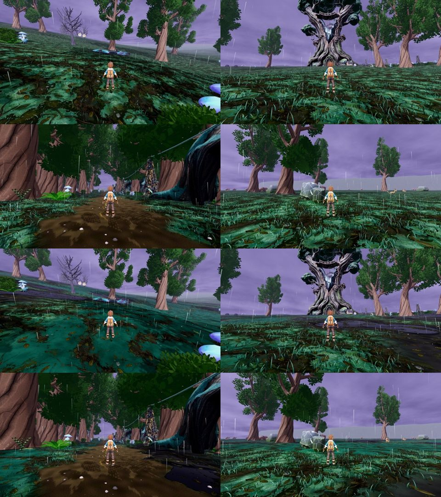

# r21 (26 Oct): authored ground zones, second round, code-blind CPU

Same arms and stands as r20; the ON arm is r21: cool umber loam #24241f with softer edges [0.36, 0.47], blue-green moss #1d3a2d over [0.53, 0.62] with tufts 90% shorter, satin black pools #07090b in the lowest loam [0.30, 0.335], the far sheet tints instead of opening, and every zone fades out between 180 and 300 m (the r20 pink horizon strip is gone).

Yardstick: JUDGE_PROMPT v1, 3 fresh judges, 3 anchor pairs (craft, f04_6_r22, p2_094_r4), seed 2121. calibrate.py linear slope 1.417, intercept -1.593, r 0.97, anchor RMSE 0.34, no warnings.

| Item | off (mapped) | on (mapped) | gain | judges (raw off -> on) |
|---|---|---|---|---|
| Stormwood ground (4 stands) | 6.15 | 6.25 | +0.10 | 5.6->5.9, 5.3->5.1, 5.5->5.6 |

All three credit the black pools ("fits the board's black pools") and no longer flag maroon soil, but read the glass-meadow moss as an over-saturated flat cyan wash ("plastic", "a texture swatch") and the pools as hard-edged decals. Carpet PARTIAL 3/3 on both arms; flat grey horizon PRESENT 3/3 on both.

Gain rule: the zone approach's first round under +0.5 (r20 +0.54 with the maroon/pink defects, r21 +0.10). Flag stays OFF. Every judge in r19-r21 names the same top lever outside the ground: the flat grey horizon band and the flat lavender sky (layered silhouettes, fog depth, storm-cloud structure). That is the next candidate (r22); the zones get at most one more round, with desaturated moss, if they come back.

