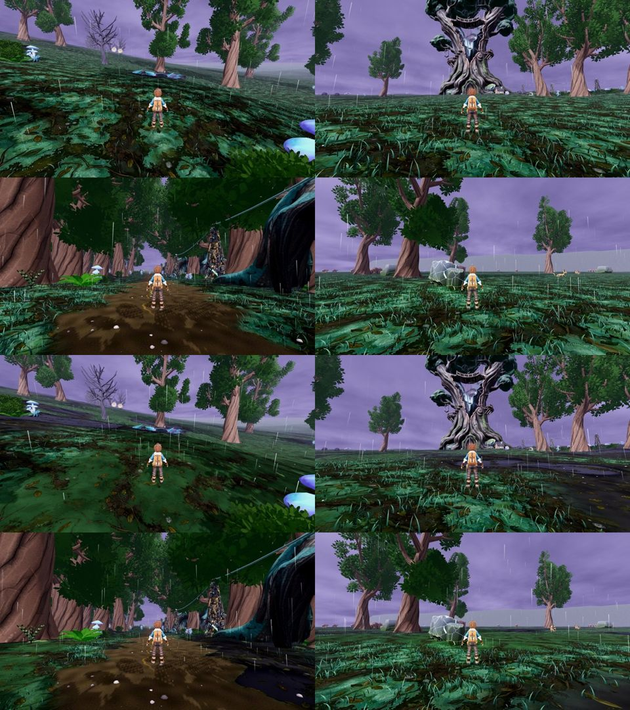

# r22 (26 Oct): authored ground zones, third round, code-blind CPU

Same arms and stands as r20/r21 (glass, stormheart approach, rod_line, crown heartstone; calm; 2x2 per side). ON = r21 with natural dark-green moss (#26361f, tint #8a9f7c; r21's #1d3a2d read as flat cyan) and softer pool edges [0.27, 0.335]. Loam #24241f, pools #07090b satin, zones fade 180-300 m, far sheet tints only.

Yardstick: JUDGE_PROMPT v1, 3 fresh judges, 3 anchor pairs (craft, f36_0_gap C6, f10_2_r3_capacitor), seed 2222. calibrate.py linear slope 1.060, intercept 0.094, r 0.80, anchor RMSE 0.72 (under the 0.75 warning), no warnings.

| Item | off (mapped) | on (mapped) | gain | judges (raw off -> on) |
|---|---|---|---|---|
| Stormwood ground (4 stands) | 5.47 | 6.00 | +0.53 | 5.0->5.4, 5.0->5.4, 5.2->5.9 |

Carpet defect: PRESENT 2/3, PARTIAL 1/3 -> PARTIAL 3/3. Flat grey horizon PRESENT 3/3 on both. All three credit the black pools, wet soil and road puddles; none flag maroon soil, a pink horizon or cyan moss. Still asked: rock zones, the crown hollow (frame 4) is still mostly carpet, the flat grey horizon and flat sky.

Gain rule: r20 +0.54 (with defects), r21 +0.10, r22 +0.53. Clears +0.5: GPU READY as its own arm (`stormwood_ground_finish.json ground_zones.enabled`).

