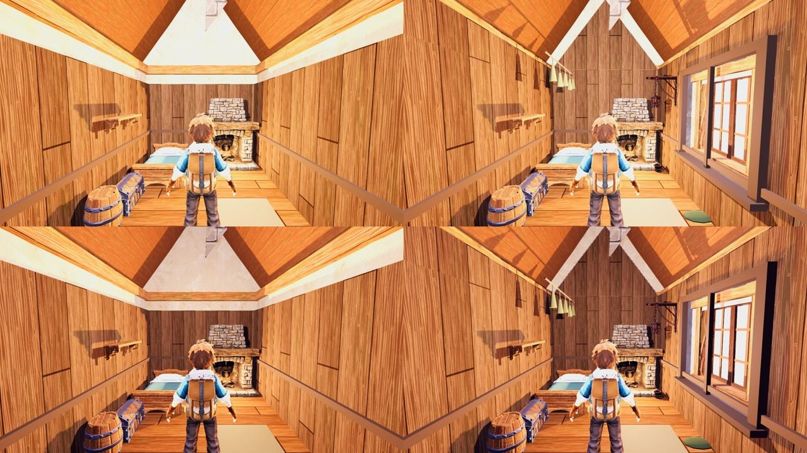

# r23 (26 Oct): Ashfoot storm finish, code-blind CPU

Arms: lane tree with `cottage_interior_finish.json storm_finish` OFF (the landed timber lining + Meshy hearth, GPU 5.82) vs ON. Stand: the F41 catalogue's `ashfoot_shelter_inside` view, re-created with `--custom` (ash_in@-364.58,459.58 focus -369.24,+1.4,464.24, pitch -4), calm (top) and break (bottom) per side.

ON adds: lining to the 3 m wall top with a timber-framed opening on the ranger station's east window, lined gable triangles to 5.1 m, a cool storm fill (#8f8ad0, 0.9) at the window, copper-tinted kit lantern, pot and bucket, five herb bundles over the bed side, moss at the wall foot.

Yardstick: JUDGE_PROMPT v1, 3 fresh judges, 3 anchor pairs (craft, f04_6_r22, f36_0_npc C4), seed 2323. calibrate.py linear slope 1.000, intercept 0.582, r 0.76, anchor RMSE 0.52, no warnings.

| Item | off (mapped) | on (mapped) | gain | judges (raw off -> on) |
|---|---|---|---|---|
| Ashfoot inside | 4.82 | 5.72 | +0.90 | 4.5->5.5, 4.4->5.2, 3.8->4.7 |

Defects (on): plaster gable FIXED 3/3; no window/storm view PARTIAL 3/3 (the panes show the bright exterior, not the purple storm; calm and break look alike); generic planks PARTIAL 3/3 (herbs and lantern read; copper and moss barely). Fixed after judging (ride-along, by all three): the deep window frame stood out "like a floating slab"; it is now a 5 cm trim flush on the lining, without the mullion. Still asked: a cooler storm grade instead of the saturated orange pine box, a visible storm through the window, stronger copper/glass/moss.

