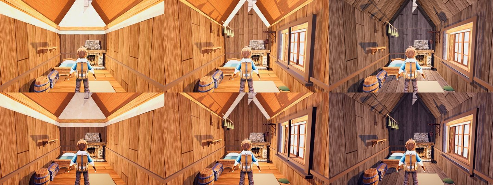

# r24 (26 Oct): Ashfoot storm grade, code-blind CPU

Arms (same `ash_in` stand, calm top / break bottom): main (storm finish OFF), r23 (storm finish ON, pre-trim frame), r24 (storm finish + `storm_finish.grade` ON: lining #a8a299 at weathering 0.9, the same cool timber over both ceiling pitches and the floor, room light #d9c6b0 at 0.75). Two candidate sets in one batch: main vs r24 and r23 vs r24. Sheet: main | r23 | r24.

Yardstick: JUDGE_PROMPT v1, 3 fresh judges, 3 anchor pairs (craft, f36_0_npc C1, f36_0_gap C1), seed 2424. calibrate.py linear slope 1.351, intercept -1.648, r 0.98, anchor RMSE 0.20, no warnings.

| Arm | mapped | judges (raw) |
|---|---|---|
| main | 4.34 | 4.2 / 4.3 / 4.8 |
| r23 storm finish | 4.93 | 4.6 / 5.0 / 5.0 |
| r24 finish + grade | 6.19 | 5.7 / 5.8 / 5.9 (identical in both sets) |

Gain: r24 over r23 +1.26, over main +1.85. Orange-box defect PRESENT -> PARTIAL 3/3; gable FIXED 3/3; window and dressing PARTIAL 3/3. All three still ask for the storm through the window (it shows warm bright light; calm and break look alike) and copper/glass/moss accents; the room is now one mid-value brown.

