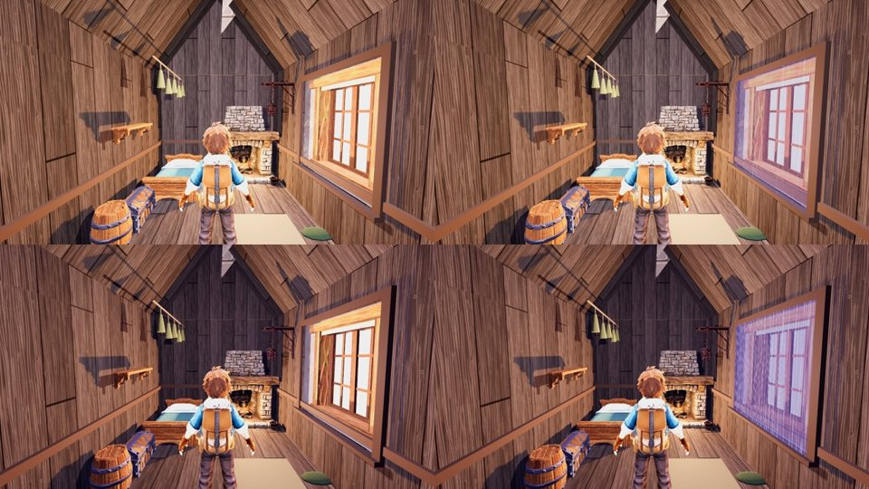

# r25 (26 Oct): Ashfoot storm pane, code-blind CPU

Arms (same `ash_in` stand, calm top / break bottom): r24 (storm finish + grade) vs r25 (+ `storm_finish.window_pane`: a pane in the window opening that tints the real exterior toward the storm purple, rain rivulets by surge phase, alpha by phase, and the surge's own flash level lifting the pane and the cool window light in Break; `cottage_storm_pane.gdshader`).

Yardstick: JUDGE_PROMPT v1, 3 fresh judges, 3 anchor pairs (craft, f04_6_r22, f36_0_gap C1), seed 2525. calibrate.py linear slope 1.094, intercept 0.032, r 0.83, anchor RMSE 0.47, no warnings.

| Item | r24 (mapped) | r25 (mapped) | gain | judges (raw r24 -> r25) |
|---|---|---|---|---|
| Ashfoot inside | 5.14 | 5.87 | +0.73 | 4.2->4.9, 4.9->5.6, 4.9->5.5 |

Storm view and calm/break defects: PRESENT 3/3 -> PARTIAL 3/3. Still asked: a real exterior (sky, tree silhouettes, lightning) instead of "a flat violet plane", a cool spill into the room, copper/glass/moss accents, less uniform plank repetition. Ashfoot chain on CPU: main 4.34 -> r23 4.93 -> r24 6.19 (r24 batch); r24 5.14 -> r25 5.87 (this batch; batches are mapped separately, so compare deltas).

