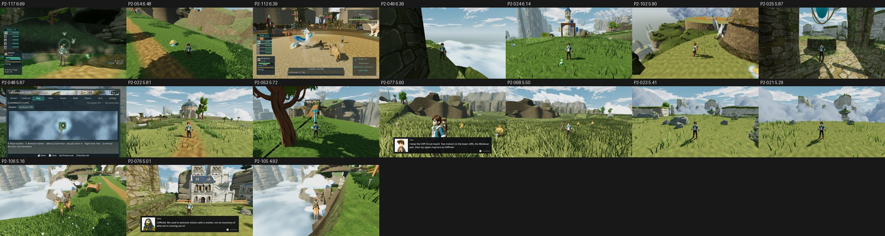

# Item scores, Cloudreach (GPU score of record), main b7a6e8bbe

- **Renderer:** GPU NVIDIA GeForce GTX 1060 3GB, OpenGL 3.3 Compatibility (repro commands as stated, --fullscreen).
- **Fit:** mean r 0.854, mean RMSE 0.58 across 2 batches (b1 r 0.84, b2 r 0.87).
- **Items:** 17 scored; 0 at or above 7.5.
- **Capture failures:** 5.
- **Unscored:** P2-118. None of their frames exist on main, so they have no score (not a zero).
  - P2-024, P2-025 (2 frame(s)): phase2_capture_locations.gd reported CATALOGUE SURVEY FAILED 0/1 on both tries: the broken_skyroad_arch day approach found 'no supported production-camera stand among 15 candidates' on main.
  - P2-024 (1 frame(s)): phase2_capture_locations.gd reported CATALOGUE SURVEY FAILED 0/1 on both tries: the old_wind_observatory day approach found 'no supported production-camera stand among 15 candidates' on main.
  - P2-117 (1 frame(s)): phase2_capture_catch.gd reported FAIL 'could not enter combat; nothing captured' on both tries (seed 2042): at the arrival gate road the wild creature road_visibility_arrival_gate_road_01_0 is 1.12 m from a 'Take Good Candy' pickup, and the pickup wins the interact offer, so the engage never fires.
  - P2-118 (1 frame(s)): same as c026 (the same phase2_capture_catch.gd command, seed 2042): FAIL 'could not enter combat; nothing captured' on both tries; the 'Take Good Candy' pickup beside road_visibility_arrival_gate_road_01_0 wins the interact offer.
- **Nearest-time frames:** `cloudreach__fight__veyra_live__live-2430`, `cloudreach__fight__veyra_live__live-3510`, `cloudreach__fight__veyra_live__live-3870` matched the same event at the nearest time within 0.5 s, because fight timings differ slightly between runs.

**Method:**
- Each phase-2 repro command was re-shot once on main on the GTX 1060, as stated (opengl3, its own resolution), with two changes:
  - `--fullscreen` was added, because the tools require an exact 1920x1080 viewport.
  - The output went to an untracked `phase2/<biome>/itemscores-gpu/` folder, because the tools reject any other location.
- Each item was judged one-sided (its 1–3 frames) with three code-blind judges per batch and high anchors.
- Mapped is the three-judge mean on the anchor scale. The defect calls are the three judges' calls on the catalogue defect.

| Item | Board row | Subject | Mapped | Defect calls |
|---|---|---|---|---|
| P2-117 | F40#13 | catch chance feedback timing | 6.69 | FIXED 3 |
| P2-054 | F40#16 | mushroom pickup variants | 6.48 | FIXED 3 |
| P2-112 | F40#5 | captain fight camera orientation | 6.39 | PARTIAL 3 |
| P2-049 | F40#15 | floating dark strips | 6.36 | FIXED 3 |
| P2-024 | F40#3 | architectural landmark read | 6.14 | PRESENT 2 / PARTIAL 1 |
| P2-102 | F40#17 | High Perches rim mushroom | 5.90 | PARTIAL 2 / FIXED 1 |
| P2-025 | F40#7 | grass and stone finish | 5.87 | PRESENT 3 |
| P2-048 | F40#14 | Cloudreach map region label | 5.87 | FIXED 3 |
| P2-022 | F40#2 | summit aviary | 5.81 | PARTIAL 3 |
| P2-053 | F40#8 | bright Cloudreach route markers | 5.72 | PARTIAL 2 / PRESENT 1 |
| P2-077 | F40#10 | dialogue foreground composition | 5.60 | PRESENT 3 |
| P2-068 | F40#9 | named NPC post readability | 5.50 | PRESENT 3 |
| P2-023 | F40#4 | exposed landform edges | 5.41 | PRESENT 2 / PARTIAL 1 |
| P2-021 | F40#1 | open terrain | 5.29 | PRESENT 3 |
| P2-106 | F40#11 | terrace edge clouds | 5.16 | PRESENT 3 |
| P2-076 | F40#12 | dialogue speaker visibility | 5.01 | PRESENT 3 |
| P2-105 | F40#6 | mounted terrace edge and cloud crossing | 4.92 | PRESENT 3 |

`_sheet_cloudreach-gpu.jpg`: the first re-shot frame of each item, sorted by score.

Raw scores, per-judge mapped scores, frames and notes are in `scores-gpu.json`. The judge files are in `yardstick/`.
