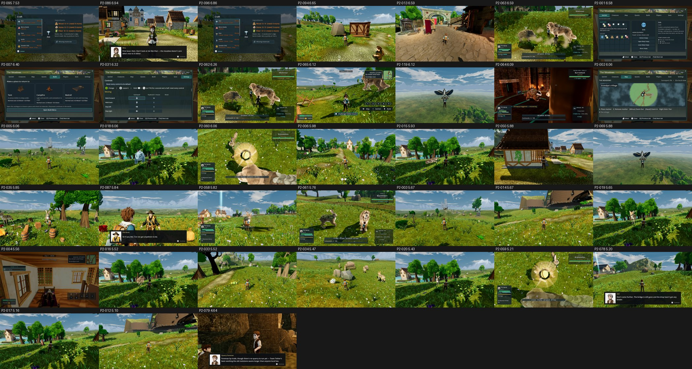

# Item scores, Meadows (GPU score of record), main b7a6e8bbe

- **Renderer:** GPU NVIDIA GeForce GTX 1060 3GB, OpenGL 3.3 Compatibility (repro commands as stated, --fullscreen).
- **Fit:** mean r 0.84, mean RMSE 0.507 across 5 batches (b1 r 0.96, b2 r 0.90, b3 r 0.88, b4 r 0.94, b5 r 0.51).
- **Items:** 38 scored; 1 at or above 7.5.
- **Capture failures:** 0.
- **Low confidence:** batch(es) 5 fit below r 0.7. Their items' mapped scores are compressed toward the middle, so read them with extra margin (marked * in the table).

**Method:**
- Each phase-2 repro command was re-shot once on main on the GTX 1060, as stated (opengl3, its own resolution), with two changes:
  - `--fullscreen` was added, because the tools require an exact 1920x1080 viewport.
  - The output went to an untracked `phase2/<biome>/itemscores-gpu/` folder, because the tools reject any other location.
- Each item was judged one-sided (its 1–3 frames) with three code-blind judges per batch and high anchors.
- Mapped is the three-judge mean on the anchor scale. The defect calls are the three judges' calls on the catalogue defect.

| Item | Board row | Subject | Mapped | Defect calls |
|---|---|---|---|---|
| P2-095 | F38#18 | craft recipe text | 7.53 | FIXED 3 |
| P2-086 | F38#16 | tournament dialogue subject identity | 6.94 | FIXED 3 |
| P2-096 | F38#38 | craft action hint contrast | 6.86 | PARTIAL 3 |
| P2-094 | F38#34 | placed wall visual | 6.65 | FIXED 3 |
| P2-013 | F38#23 | Tether Relay yard | 6.59 | FIXED 3 |
| P2-063 | F38#11 | shared fight tell and hit effects | 6.59 | PARTIAL 3 |
| P2-001 | F38#9 | menu shell | 6.58 | PARTIAL 3 |
| P2-007 | F38#10 | secondary menu panels | 6.40 | PARTIAL 2 / PRESENT 1 |
| P2-031 | F38#27 | settings and binding instructions | 6.32* | PRESENT 3 |
| P2-062 | F38#3 | fight camera and creature scale | 6.26* | PRESENT 2 / PARTIAL 1 |
| P2-065 | F38#29 | trainer defeated presentation | 6.12* | PRESENT 3 |
| P2-119 | F38#8 | Fly carrier grip pose | 6.12* | PRESENT 3 |
| P2-064 | F38#28 | Warden arena boundary | 6.09* | PRESENT 3 |
| P2-002 | F38#4 | map | 6.06 | PARTIAL 3 |
| P2-005 | F38#21 | ground cover | 6.06 | PRESENT 3 |
| P2-018 | F38#25 | shiny palette distinction | 6.06 | PARTIAL 3 |
| P2-060 | F38#14 | catch effect finish | 6.06 | PARTIAL 3 |
| P2-006 | F38#22 | mill and settlements | 5.98 | PARTIAL 2 / PRESENT 1 |
| P2-015 | F38#1 | creature collapse and rest | 5.93* | PARTIAL 3 |
| P2-050 | F38#35 | human post poses | 5.88 | PRESENT 3 |
| P2-069 | F38#15 | flight and landing pose read | 5.88 | PRESENT 3 |
| P2-035 | F38#32 | camp and workshop prop legibility | 5.85 | PRESENT 3 |
| P2-087 | F38#17 | named trainer dialogue subject visibility | 5.84* | PRESENT 3 |
| P2-058 | F38#7 | catch aim readability | 5.82 | PRESENT 3 |
| P2-061 | F38#33 | catch result hierarchy | 5.76 | PRESENT 2 / PARTIAL 1 |
| P2-003 | F38#20 | Team Tether stronghold | 5.67 | PRESENT 3 |
| P2-014 | F38#24 | distant mountains | 5.67 | PARTIAL 3 |
| P2-019 | F38#31 | alpha rarity read | 5.65 | PRESENT 3 |
| P2-004 | F38#19 | exploration HUD | 5.56 | PARTIAL 3 |
| P2-016 | F38#2 | creature hurt and movement poses | 5.52 | PARTIAL 2 / PRESENT 1 |
| P2-033 | F38#6 | ground pickup identity | 5.52 | PRESENT 2 / PARTIAL 1 |
| P2-034 | F38#12 | harvest reward identity | 5.47 | PRESENT 3 |
| P2-020 | F38#26 | creature ground contact | 5.43 | PARTIAL 2 / PRESENT 1 |
| P2-059 | F38#13 | catch sequence camera framing | 5.21 | PRESENT 3 |
| P2-078 | F38#36 | dialogue speaker occlusion | 5.20 | PRESENT 2 / PARTIAL 1 |
| P2-017 | F38#5 | normal creature scale | 5.16 | PRESENT 3 |
| P2-012 | F38#30 | Burrow Warrens hillside | 5.10 | PRESENT 3 |
| P2-079 | F38#37 | Meadows dialogue rock obstruction | 4.64 | PRESENT 2 / PARTIAL 1 |

`_sheet_meadows-gpu.jpg`: the first re-shot frame of each item, sorted by score.

Raw scores, per-judge mapped scores, frames and notes are in `scores-gpu.json`. The judge files are in `yardstick/`.
