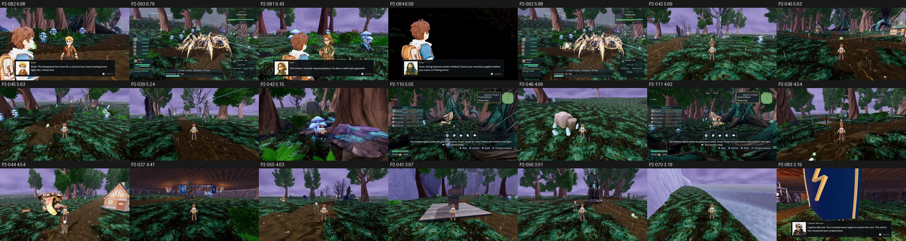

# Item scores, Stormwood (GPU score of record), main b7a6e8bbe

- **Renderer:** GPU NVIDIA GeForce GTX 1060 3GB, OpenGL 3.3 Compatibility (repro commands as stated, --fullscreen).
- **Fit:** mean r 0.903, mean RMSE 0.457 across 3 batches (b1 r 0.81, b2 r 0.99, b3 r 0.91).
- **Items:** 21 scored; 0 at or above 7.5.
- **Capture failures:** 1.

**Method:**
- Each phase-2 repro command was re-shot once on main on the GTX 1060, as stated (opengl3, its own resolution), with two changes:
  - `--fullscreen` was added, because the tools require an exact 1920x1080 viewport.
  - The output went to an untracked `phase2/<biome>/itemscores-gpu/` folder, because the tools reject any other location.
- Each item was judged one-sided (its 1–3 frames) with three code-blind judges per batch and high anchors.
- Mapped is the three-judge mean on the anchor scale. The defect calls are the three judges' calls on the catalogue defect.

| Item | Board row | Subject | Mapped | Defect calls |
|---|---|---|---|---|
| P2-082 | F41#11 | named character portrait identity | 6.98 | FIXED 3 |
| P2-093 | F41#6 | named wild danger and opening cues | 6.76 | FIXED 3 |
| P2-081 | F41#7 | named trainer dialogue identity | 6.43 | FIXED 3 |
| P2-084 | F41#20 | named character dialogue reuse | 6.09 | FIXED 3 |
| P2-092 | F41#3 | named wild fight actor spacing | 5.98 | PRESENT 2 / PARTIAL 1 |
| P2-042 | F41#2 | Surge phase presentation | 5.69 | PARTIAL 3 |
| P2-040 | F41#12 | charged road surface | 5.63 | FIXED 3 |
| P2-045 | F41#14 | candy pickup tiers | 5.63 | PARTIAL 3 |
| P2-039 | F41#5 | forest ground and distance layers | 5.24 | PRESENT 3 |
| P2-043 | F41#19 | Glass Field spike bases | 5.15 | PARTIAL 2 / FIXED 1 |
| P2-110 | F41#16 | Hollows fight loss result clarity | 5.05 | PRESENT 3 |
| P2-046 | F41#9 | harvest resource identity | 4.99 | PARTIAL 3 |
| P2-111 | F41#21 | Hollows victory reward tiles | 4.92 | PRESENT 3 |
| P2-038 | F41#4 | named destination identities | 4.54 | PARTIAL 2 / PRESENT 1 |
| P2-044 | F41#13 | electric creature finish | 4.54 | PRESENT 2 / PARTIAL 1 |
| P2-037 | F41#1 | Stormheart finale | 4.41 | PRESENT 3 |
| P2-055 | F41#8 | named character silhouettes | 4.03 | PRESENT 3 |
| P2-041 | F41#17 | Crown Arch | 3.97 | PARTIAL 2 / PRESENT 1 |
| P2-056 | F41#18 | uniformed character readability | 3.91 | PRESENT 3 |
| P2-070 | F41#10 | Glass Sink landmark | 3.19 | PARTIAL 2 / PRESENT 1 |
| P2-083 | F41#15 | dialogue foreground obstruction | 3.19 | PRESENT 3 |

`_sheet_stormwood-gpu.jpg`: the first re-shot frame of each item, sorted by score.

Raw scores, per-judge mapped scores, frames and notes are in `scores-gpu.json`. The judge files are in `yardstick/`.
