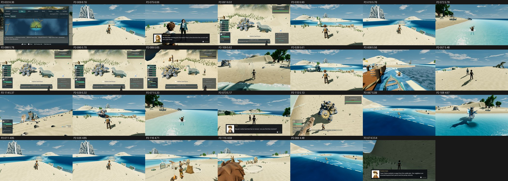

# Item scores, Tidewake (GPU score of record), main b7a6e8bbe

- **Renderer:** GPU NVIDIA GeForce GTX 1060 3GB, OpenGL 3.3 Compatibility (repro commands as stated, --fullscreen).
- **Fit:** mean r 0.958, mean RMSE 0.362 across 3 batches (b1 r 0.95, b2 r 0.97, b3 r 0.96).
- **Items:** 27 scored; 0 at or above 7.5.
- **Capture failures:** 6.
- **Unscored:** P2-101, P2-103. None of their frames exist on main, so they have no score (not a zero).
  - P2-101 (3 frame(s)): the Venn full fight ended at 188 s on main (fight active=false at 189.2 s), so no frame exists at 180.08 (tell-ended), 208 or 216 s; every enemy hit also logs SCRIPT ERROR 'neutral_worst_frac' at tests/helpers/combat_depth_pilot.gd:199 (cause: tests/capture_tidewake_named_fights.gd:368 resets the pilot _tally without the neutral_worst_frac key that tests/helpers/combat_depth_pilot.gd:199 reads).
  - P2-103 (2 frame(s)): the Venn resolve fight stopped at 98.4 s on main (fight active=false) with no win or aftermath frame; every enemy hit logs SCRIPT ERROR 'neutral_worst_frac' at tests/helpers/combat_depth_pilot.gd:199 (cause: tests/capture_tidewake_named_fights.gd:368 resets the pilot _tally without the neutral_worst_frac key that tests/helpers/combat_depth_pilot.gd:199 reads).
  - P2-103 (1 frame(s)): the Nerissa resolve run reported 1 failure: SCRIPT ERROR 'previously freed instance' in _pose (phase2_capture_tidewake_fights.gd) and _record (tests/capture_tidewake_named_fights.gd:423) after 40 s, before the win frame.
- **Nearest-time frames:** `tidewake__fight__venn__tell-start-000_48`, `tidewake__fight__venn__tell-start-001_65` matched the same event at the nearest time within 0.5 s, because fight timings differ slightly between runs.

**Method:**
- Each phase-2 repro command was re-shot once on main on the GTX 1060, as stated (opengl3, its own resolution), with two changes:
  - `--fullscreen` was added, because the tools require an exact 1920x1080 viewport.
  - The output went to an untracked `phase2/<biome>/itemscores-gpu/` folder, because the tools reject any other location.
- Each item was judged one-sided (its 1–3 frames) with three code-blind judges per batch and high anchors.
- Mapped is the three-judge mean on the anchor scale. The defect calls are the three judges' calls on the catalogue defect.

| Item | Board row | Subject | Mapped | Defect calls |
|---|---|---|---|---|
| P2-032 | F39#25 | map active region | 6.36 | FIXED 3 |
| P2-009 | F39#10 | water and island depth | 6.19 | FIXED 3 |
| P2-075 | F39#26 | dialogue foreground obstruction | 6.06 | PARTIAL 3 |
| P2-091 | F39#28 | fight boss title overlay | 6.02 | FIXED 3 |
| P2-030 | F39#4 | shiny creature finish | 5.90 | FIXED 3 |
| P2-010 | F39#2 | Veilfall silhouette | 5.78 | PARTIAL 2 / FIXED 1 |
| P2-072 | F39#14 | swimmer water contact | 5.78 | PARTIAL 3 |
| P2-088 | F39#19 | fight team roster contrast | 5.78 | PARTIAL 2 / FIXED 1 |
| P2-090 | F39#20 | fight background creature ground contact | 5.70 | PRESENT 3 |
| P2-089 | F39#7 | fight actor composition | 5.65 | PARTIAL 2 / PRESENT 1 |
| P2-109 | F39#22 | Aquaryn dismount camera obstruction | 5.62 | FIXED 3 |
| P2-028 | F39#6 | creature faint state | 5.61 | PARTIAL 3 |
| P2-008 | F39#1 | shore landforms | 5.56 | PARTIAL 3 |
| P2-057 | F39#27 | grass around named characters | 5.48 | FIXED 3 |
| P2-114 | F39#23 | catch chance HUD contrast | 5.37 | PRESENT 3 |
| P2-029 | F39#24 | creature rest poses | 5.32 | PARTIAL 3 |
| P2-071 | F39#5 | surface swimming trainer pose | 5.20 | PARTIAL 3 |
| P2-073 | F39#18 | dialogue camera framing | 5.17 | PRESENT 3 |
| P2-113 | F39#9 | catch camera distance | 5.13 | PARTIAL 2 / PRESENT 1 |
| P2-067 | F39#17 | current restoration environment | 5.09 | PRESENT 3 |
| P2-108 | F39#8 | Aquaryn mounted-water pose | 4.97 | PRESENT 3 |
| P2-011 | F39#3 | named destination read | 4.85 | PRESENT 3 |
| P2-026 | F39#15 | Veilfall approach shallows | 4.85 | PRESENT 3 |
| P2-116 | F39#13 | authored camp workbench identity | 4.71 | PRESENT 3 |
| P2-115 | F39#12 | authored camp creature bed silhouette | 4.59 | PRESENT 2 / PARTIAL 1 |
| P2-066 | F39#16 | live current streaks | 4.48 | PRESENT 3 |
| P2-074 | F39#29 | dialogue speaker visibility | 3.54 | PRESENT 3 |

`_sheet_tidewake-gpu.jpg`: the first re-shot frame of each item, sorted by score.

Raw scores, per-judge mapped scores, frames and notes are in `scores-gpu.json`. The judge files are in `yardstick/`.
